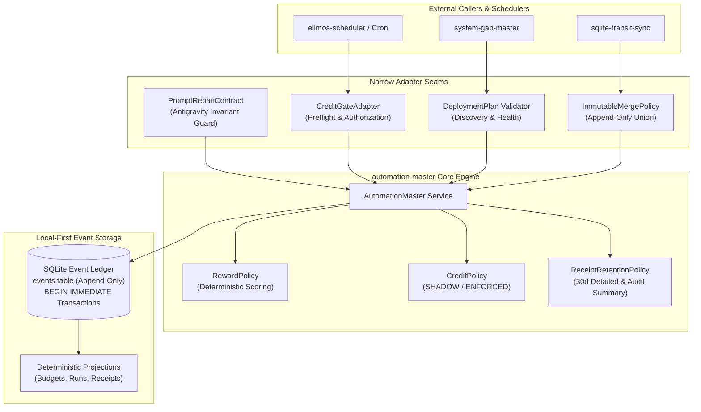
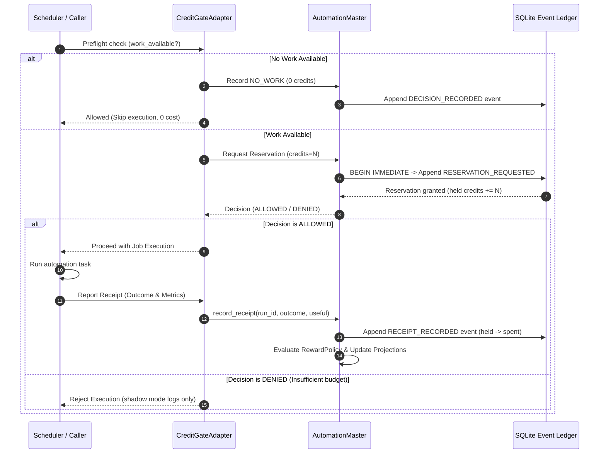
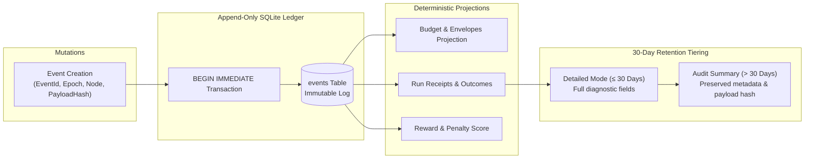

# automation-master


[](https://pytest.org)
[](pyproject.toml)
[](https://www.python.org)
[](ARCHITECTURE.md)
[](pyproject.toml)
[](SECURITY.md)
[](SECURITY.md)
[](LICENSE)
[](https://github.com/dev-bricks)
[](https://github.com/open-bricks)
[](llms.txt)

> [!NOTE]
> Quick index for LLMs and AI coding agents: see [llms.txt](llms.txt) for context, boundaries, and API signatures.

`automation-master` is a private-by-default, local-first control and governance module for
scheduled automation families. It registers comparable variants, calculates
explainable reward scores, assigns epoch-scoped credit envelopes, records run
receipts, and proposes throttling inputs.

It does **not** schedule processes, start jobs, replace `task-master`, or replace
`ticket-master`. Integration with schedulers (such as `ellmos-scheduler`), `system-gap-master`, and
`sqlite-transit-sync` happens through narrow, fail-closed adapters.

---

## Architecture



---

## Reservation & Credit Governance Flow



---

## Event Sourcing & Projection Lifecycle



---

## Safety Model & Governance Invariants

- **Fail-Closed by Default**: Enforcement starts in `disabled` or `shadow` mode. Hard gating requires explicit policy activation.
- **Zero Cost for Inactive Runs**: `NO_WORK` preflight costs 0 credits. A late `NO_WORK` outcome immediately releases held reservations.
- **Critical Exemption Invariant**: Unique, safety-critical, and deadline-bound automations retain guaranteed minimum-coverage exemptions.
- **Immutable Event Ledger**: Every durable state change is an immutable event with an event ID, node ID, budget epoch, entity version, and SHA-256 payload hash.
- **Local Transactional Integrity**: Local reservations use `BEGIN IMMEDIATE` SQLite transactions; cross-host synchronization operates with eventual consistency.
- **Zero-Egress & Credential Safety**: Raw payloads and credential patterns are never exported or transmitted.
- **Receipt Retention**: Projections preserve rich execution details for 30 days, transitioning smoothly to audit summaries while keeping ledger integrity intact.

---

## Quick Start

### Installation

```powershell
python -m pip install -e ".[dev]"
```

### CLI Usage

```powershell
# Initialize local ledger
automation-master --db .\pilot.db --node workstation init

# Register an automation family
automation-master --db .\pilot.db --node workstation register-family research "Research Pipeline"

# Allocate epoch budget
automation-master --db .\pilot.db --node workstation allocate 2026-W34 research 8 seed-1

# Check current status and budget consumption
automation-master --db .\pilot.db --node workstation status --epoch 2026-W34 --scope research
```

> [!TIP]
> The production database is isolated outside synchronized cloud storage folders:
> - **Windows**: `%LOCALAPPDATA%\ellmos\automation-master\automation-master.db`
> - **Linux/macOS**: `$XDG_STATE_HOME/ellmos/automation-master/automation-master.db`

### Python API Example

```python
from automation_master import EnforcementMode, EventStore, RunClass
from automation_master.adapters import CreditGateAdapter
from automation_master.service import AutomationMaster, CreditPolicy

# Initialize local service and event store
master = AutomationMaster(EventStore("pilot.db"), node_id="workstation")

# Allocate epoch credit envelope
master.allocate_budget(
    budget_epoch="2026-W34",
    scope_id="research",
    credits=8,
    allocation_id="seed-1",
)

# Configure credit gate adapter in shadow mode
gate = CreditGateAdapter(
    master,
    CreditPolicy(mode=EnforcementMode.SHADOW, overdraft_limit=2),
)

# Authorize incoming scheduled task
decision = gate.authorize(
    run_id="run-1",
    budget_epoch="2026-W34",
    scope_id="research",
    work_item_id="paper-1",
    work_available=True,
    credits=1,
    run_class=RunClass.COMPARABLE,
)
```

---

## Ecosystem & Related Projects

`automation-master` is part of the **dev-bricks** ecosystem and the **open-bricks** open-source suite:

| Project | Organization | Description | Role in Architecture |
|---|---|---|---|
| [`DevCenter`](https://github.com/dev-bricks/DevCenter) | `dev-bricks` | Developer cockpit, tool health & system orchestration | System monitoring & developer dashboard |
| [`CodeBox`](https://github.com/dev-bricks/CodeBox) | `dev-bricks` | Sandboxed Python code execution runner | Safe, isolated script and task execution |
| [`MethodenAnalyser`](https://github.com/dev-bricks/MethodenAnalyser) | `dev-bricks` | Test methodology & psychometrics evaluation engine | Diagnostic validation & method scoring |
| [`companion-for-agy`](https://github.com/ellmos-ai/companion-for-agy) | `ellmos-ai` | PTY-based stdout-capture wrapper for agy/Gemini CLI | Multi-agent subprocess orchestration |
| [`safe-start-for-codex`](https://github.com/dev-bricks/safe-start-for-codex) | `dev-bricks` | Isolated sandbox launcher for coding agents | Secure execution sandbox |
| [`automizer-for-claude-desktop`](https://github.com/dev-bricks/automizer-for-claude-desktop) | `dev-bricks` | Process launcher & automation bridge for Claude Desktop | Desktop agent orchestration |
| [`CareCenter-for-Codex`](https://github.com/dev-bricks/CareCenter-for-Codex) | `dev-bricks` | Care documentation & clinical process assistant | Assistive workflow management |
| [`WinStorePackager`](https://github.com/file-bricks/WinStorePackager) | `file-bricks` | MSIX packaging & desktop app deployment pipeline | Desktop app distribution |
| [`ProFiler`](https://github.com/file-bricks/ProFiler) | `file-bricks` | Fast, local-first file categorizer & inspector | File asset organization |
| [`ExplorerPro`](https://github.com/file-bricks/ExplorerPro) | `file-bricks` | Multi-tab desktop file explorer with AI tags | File navigation & index management |
| [`DokuZen`](https://github.com/doc-bricks/DokuZen) | `doc-bricks` | Local-first document workflow & extraction engine | Document OCR & indexing |
| [`PDFtoPDFocr`](https://github.com/doc-bricks/PDFtoPDFocr) | `doc-bricks` | Local-first batch OCR conversion tool | PDF OCR processing |
| [`MediaBrain`](https://github.com/doc-bricks/MediaBrain) | `doc-bricks` | Local AI media indexer and transcription engine | Audio & video knowledge digest |
| [`ellmos-controlcenter-mcp`](https://github.com/ellmos-ai/ellmos-controlcenter-mcp) | `ellmos-ai` | Gateway & tool orchestration MCP server | MCP tool coordination |
| [`ellmos-filecommander-mcp`](https://github.com/ellmos-ai/ellmos-filecommander-mcp) | `ellmos-ai` | Safe filesystem management MCP server | Sandboxed file operations |
| [`ellmos-codecommander-mcp`](https://github.com/ellmos-ai/ellmos-codecommander-mcp) | `ellmos-ai` | Code inspection & AST refactoring MCP server | AST code transformation |
| [`open-bricks`](https://github.com/open-bricks) | `open-bricks` | Umbrella organization for developer & desktop tools | Ecosystem umbrella |

---

## Documentation & Contracts

- [ARCHITECTURE.md](ARCHITECTURE.md): Detailed architectural layers, event schema, and reservation mechanics.
- [SECURITY.md](SECURITY.md): Security policy, local-first storage invariants, and confidential vulnerability reporting.
- [CHANGELOG.md](CHANGELOG.md): Version history, releases, and discoverability records.
- [contracts/scheduler-credit-gate.md](contracts/scheduler-credit-gate.md): Scheduler credit gate adapter specifications.
- [contracts/receipt-retention.md](contracts/receipt-retention.md): 30-day receipt retention and audit summary contract.
- [contracts/deployment-plan.schema.json](contracts/deployment-plan.schema.json): JSON schema for System-Gap deployment plans.

---

## Security & Contact

For security-related issues or confidential inquiries:
- **Security Team**: `security@ellmos.ai`
- **Maintainer**: `support@lukasgeiger.com`

---

## License

This project is licensed under the [MIT License](LICENSE).
