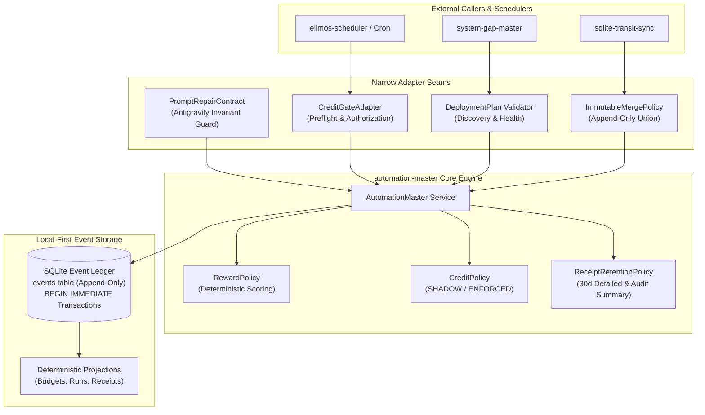
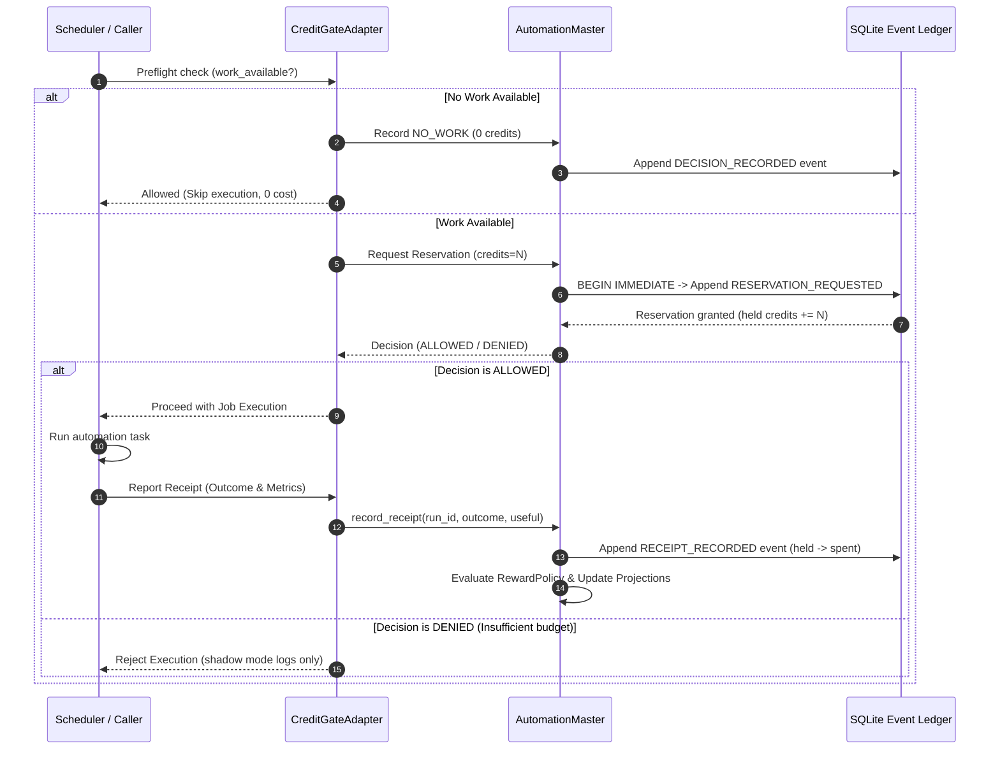

# automation-master


[](https://pytest.org)
[](https://www.python.org)
[](LICENSE)
[](https://github.com/dev-bricks)
[](https://github.com/open-bricks)
[](llms.txt)

> [!NOTE]
> Quick index for LLMs and AI coding agents: see [llms.txt](llms.txt) for context, boundaries, and API signatures.

`automation-master` is a private-by-default, local-first control module for
scheduled automation families. It registers comparable variants, calculates
explainable reward scores, assigns epoch-scoped credit envelopes, records run
receipts, and proposes throttling inputs.

It does **not** schedule processes, start jobs, replace `task-master`, or replace
`ticket-master`. Integration with `ellmos-scheduler`, `system-gap-master`, and
`sqlite-transit-sync` happens through narrow adapters.

## Architecture



## Reservation & Credit Governance Flow



## Safety model

- Enforcement starts in `disabled` or `shadow` mode.
- `NO_WORK` preflight costs no credit. A late `NO_WORK` receipt releases a
  reservation.
- Hard denial applies only to ordinary comparable runs when explicitly enabled.
- Unique, safety, and deadline runs retain minimum-coverage exemptions.
- Every durable mutation is an immutable event with an event ID, node ID,
  budget epoch, entity version, optional tombstone, and content hash.
- Local reservations use `BEGIN IMMEDIATE`; cross-host state is eventually
  consistent. The module makes no global hard-atomicity claim.
- Raw payloads are not included in diagnostic exports.
- Receipt projections retain detailed fields for 30 days, then keep an audit
  summary with the immutable event metadata and payload hash; the ledger is
  never rewritten by retention.

## Quick start

```powershell
python -m pip install -e ".[dev]"
automation-master --db .\pilot.db --node workstation init
automation-master --db .\pilot.db --node workstation register-family research "Research"
automation-master --db .\pilot.db --node workstation allocate 2026-W31 research 8 seed-1
automation-master --db .\pilot.db --node workstation status --epoch 2026-W31 --scope research
```

The production default database is outside synchronized folders:
`%LOCALAPPDATA%\ellmos\automation-master\automation-master.db` on Windows or
`$XDG_STATE_HOME/ellmos/automation-master/automation-master.db` elsewhere.

## Library example

```python
from automation_master import EnforcementMode, EventStore, RunClass
from automation_master.service import AutomationMaster, CreditPolicy
from automation_master.adapters import CreditGateAdapter

master = AutomationMaster(EventStore("pilot.db"), node_id="workstation")
master.allocate_budget(
    budget_epoch="2026-W31",
    scope_id="research",
    credits=8,
    allocation_id="seed-1",
)
gate = CreditGateAdapter(
    master,
    CreditPolicy(mode=EnforcementMode.SHADOW, overdraft_limit=2),
)
decision = gate.authorize(
    run_id="run-1",
    budget_epoch="2026-W31",
    scope_id="research",
    work_item_id="paper-1",
    work_available=True,
    credits=1,
    run_class=RunClass.COMPARABLE,
)
```

## Ecosystem & Related Projects

`automation-master` is part of the **dev-bricks** ecosystem and the **open-bricks** open-source initiative:

| Project | Description | Role in Suite |
|---|---|---|
| [`DevCenter`](https://github.com/dev-bricks/DevCenter) | Developer dashboard, tool health & system orchestration | System monitoring & developer cockpit |
| [`CodeBox`](https://github.com/dev-bricks/CodeBox) | Sandboxed code execution engine & runner | Safe isolated execution runtime |
| [`MethodenAnalyser`](https://github.com/dev-bricks/MethodenAnalyser) | Test methodology & psychometrics engine | Psychological analysis & validation |
| [`companion-for-agy`](https://github.com/ellmos-ai/companion-for-agy) | PTY-based stdout-capture wrapper for agy/Gemini CLI | Multi-agent subprocess orchestration |
| [`CareCenter-for-Codex`](https://github.com/dev-bricks/CareCenter-for-Codex) | Client care documentation & clinical process assistant | Specialized assistive workflow agent |

See [ARCHITECTURE.md](ARCHITECTURE.md), [SECURITY.md](SECURITY.md), and the
adapter contracts under `contracts/`, including
[`contracts/receipt-retention.md`](contracts/receipt-retention.md) and the
fail-closed prompt-repair verifier contract.

