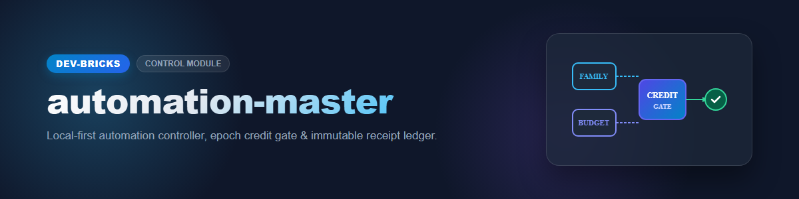
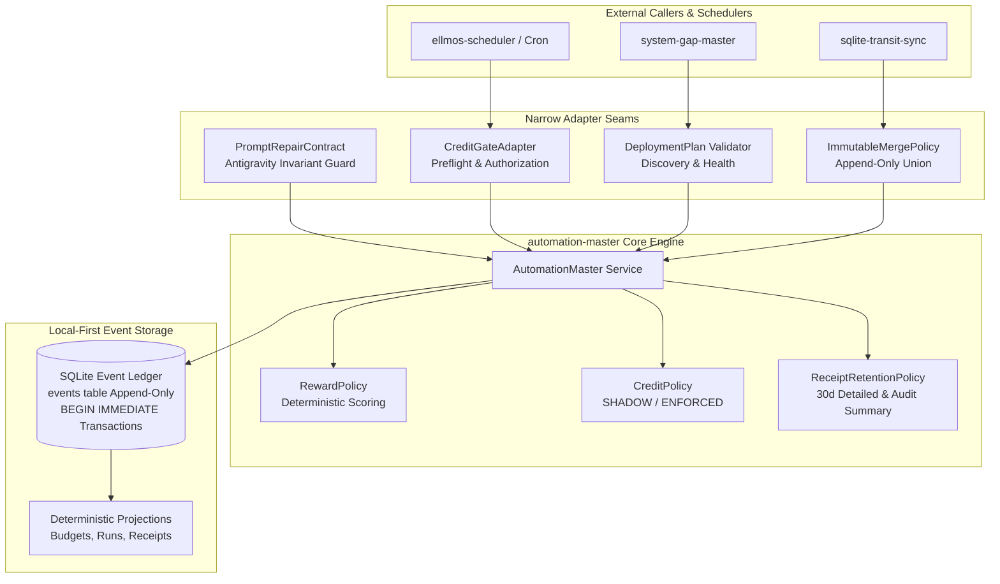
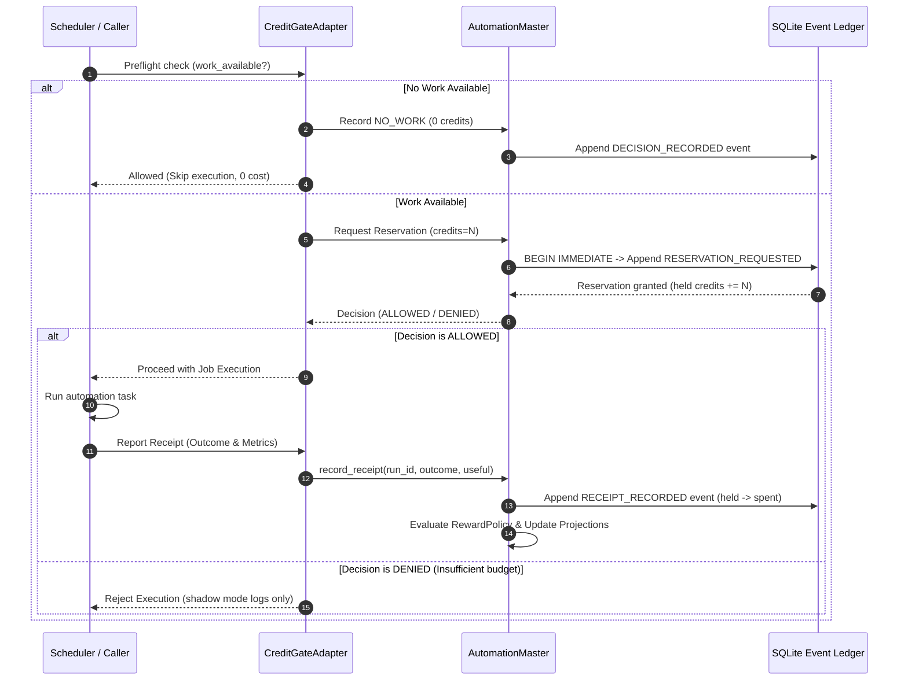

# automation-master



[](https://github.com/dev-bricks/automation-master/actions/workflows/ci.yml)
[](pyproject.toml)
[](https://github.com/astral-sh/ruff)
[](https://pytest.org)
[](https://www.python.org)
[](ARCHITECTURE.md)
[](pyproject.toml)
[](SECURITY.md)
[](SECURITY.md)
[](SECURITY.md)
[](SECURITY.md)
[](THIRD_PARTY_LICENSES.md)
[](THIRD_PARTY_LICENSES.md)
[](THIRD_PARTY_LICENSES.txt)
[](NOTICE)
[](MARKETING-LOG.txt)
[](MARKETING-LOG.txt)
[](CONTRIBUTING.md)
[](LICENSE)
[](https://github.com/dev-bricks)
[](https://github.com/open-bricks)
[](llms.txt)

> [!NOTE]
> AI / LLM Context Index: See [llms.txt](llms.txt) for machine-readable context, invariant boundaries, and public API signatures.
> German Edition: A complete German version is available in [README_de.md](README_de.md).

---

### Quick Navigation

| # | Section | Nav Anchor | Operational Scope |
|---|---|---|---|
| 01 | [1. Executive Summary & Core Identity](#sec-01) | [`#sec-01`](#sec-01) | Local-first governance, credit envelopes & zero-daemon runtime |
| 02 | [2. Visual Architecture & System Topology](#sec-02) | [`#sec-02`](#sec-02) | ASCII Four-View Topology projection & Mermaid decoupled flow |
| 03 | [3. End-to-End Governance & Credit Lifecycle](#sec-03) | [`#sec-03`](#sec-03) | Preflight skip, atomic reservations & reward evaluations |
| 04 | [4. Target Personas & High-Intent SEO Queries](#sec-04) | [`#sec-04`](#sec-04) | 4 technical personas `[PERSONA-01..04]` & bilingual discoverability |
| 05 | [5. Comparative Matrix vs. Alternatives](#sec-05) | [`#sec-05`](#sec-05) | 10-dimension comparison vs cron, Airflow, AWS Budgets & ad-hoc |
| 06 | [6. Governance & Runtime Invariants Matrix](#sec-06) | [`#sec-06`](#sec-06) | Ten strict invariants `INV-LOCAL-01` through `INV-ISOLAT-10` |
| 07 | [7. Event Sourcing & Projection Lifecycle](#sec-07) | [`#sec-07`](#sec-07) | Append-only ledger mutations, projections & 30-day retention tier |
| 08 | [8. Installation & Prerequisites](#sec-08) | [`#sec-08`](#sec-08) | Python 3.10+ prerequisites & editable pip packaging |
| 09 | [9. CLI Usage & Operations](#sec-09) | [`#sec-09`](#sec-09) | CLI commands: init, register-family, allocate, and status |
| 10 | [10. Python API Integration & Extension Points](#sec-10) | [`#sec-10`](#sec-10) | Core service initialization, gate adapter & policy configuration |
| 11 | [11. Data Storage & Multi-OS Layout](#sec-11) | [`#sec-11`](#sec-11) | Safe state placement in LocalAppData / XDG outside cloud sync |
| 12 | [12. Architectural Contracts & Schema Specifications](#sec-12) | [`#sec-12`](#sec-12) | Formal contract specifications and JSON schemas |
| 13 | [13. Sibling Tools & Ecosystem Matrix](#sec-13) | [`#sec-13`](#sec-13) | Cross-tool interoperability across dev-bricks & open-bricks |
| 14 | [14. Testing, Verification & Quality Gates](#sec-14) | [`#sec-14`](#sec-14) | Pytest, contract tests, Ruff AST checks & bytecode compilation |
| 15 | [15. Security Policy & Vulnerability SLAs (48h Response SLA)](#sec-15) | [`#sec-15`](#sec-15) | Confidential reporting, 48h SLA & 5-day triage commitment |
| 16 | [16. Third-Party Licenses & Level 1 SBOM](#sec-16) | [`#sec-16`](#sec-16) | Pure stdlib, Level 1 SBOM, and plain-text companion |
| 17 | [17. Discovery Keywords & AI Agent Index](#sec-17) | [`#sec-17`](#sec-17) | 20 saturated keywords, llms.txt & module manifest index |
| 18 | [18. Statutory Notice, Liability Limitation & License (§ 521 BGB)](#sec-18) | [`#sec-18`](#sec-18) | German civil code § 521 BGB Gefälligkeitsrecht & MIT License |

---

<a id="sec-01"></a>
## <a id="1-executive-summary--core-identity"></a><a id="executive-summary--core-identity"></a><a id="executive-summary"></a><a id="uebersicht--management-summary"></a>1. Executive Summary & Core Identity

`automation-master` is a private-by-default, local-first control and governance module for recurring automation families and multi-agent AI pipelines. It registers comparable automation variants, calculates explainable reward scores, manages epoch-scoped credit envelopes, records immutable run receipts, and proposes throttling decisions.

The module operates without spawning processes or replacing schedulers like `ellmos-scheduler`, `task-master`, or `ticket-master`. Instead, it provides deterministic policy governance and admission control via narrow, fail-closed contract adapters.

---

<a id="sec-02"></a>
## <a id="2-visual-architecture--system-topology"></a><a id="visual-architecture--system-topology"></a><a id="system-architecture"></a><a id="visuelle-systemarchitektur--topologie"></a>2. Visual Architecture & System Topology

### ASCII Four-View Architectural Topology Projection

```text
========================================================================================
[VIEW 1: CLIENT RUNTIMES & AGENT DRIVERS]
----------------------------------------------------------------------------------------
 +-------------------------+  +-------------------------+  +--------------------------+
 | Schedulers (Cron/Systemd)|  | Multi-Agent Runtimes    |  | System Gap & Sync Engines|
 | (ellmos-scheduler)      |  | (Claude Code, Antigrav) |  | (system-gap-master, sync)|
 +------------+------------+  +------------+------------+  +------------+-------------+
              |                            |                            |
              +----------------------------+----------------------------+
                                           |
                                           v
========================================================================================
[VIEW 2: AUTOMATION-MASTER CORE GOVERNANCE ENGINE]
----------------------------------------------------------------------------------------
 +------------------------------------------------------------------------------------+
 | AutomationMaster Service (`automation_master.service`)                             |
 |                                                                                    |
 |  [CreditGateAdapter] ──> [RewardPolicy]      ──> [CreditPolicy]    ──> [Retention] |
 |   Preflight & Auth        Explainable Score       SHADOW / ENFORCED     30d Lifecycle|
 |   0-Cost NO_WORK skips    Decay & Penalties       Epoch Envelopes       Audit Log    |
 +-----------------------------------+------------------------------------------------+
                                     |
                         (BEGIN IMMEDIATE Transaction)
                                     v
========================================================================================
[VIEW 3: ATOMIC SQLite PERSISTENCE & CONCURRENCY] [VIEW 4: GOVERNANCE, SECURITY & PERIMETER]
------------------------------------------------- ------------------------------------------
 Local SQLite Event Ledger                         Governance, Compliance & Zero-Egress
 +----------------------------------------------+  +---------------------------------------+
 | Local AppData / XDG State (~/.ellmos/state/)  |  | Zero Network Egress / 100% Offline    |
 | Append-Only `events` table (SHA-256 Hashed)   |  | Non-Elevation (RunAsInvoker User Mode)|
 | PRAGMA journal_mode = WAL & Busy Retries      |  | Zero-Copyleft Permissive Footprint    |
 | Deterministic Budget & Receipt Projections   |  | Level 1 SBOM Text Companion & 48h SLA |
 +----------------------------------------------+  +---------------------------------------+
========================================================================================
```

The diagram below illustrates the decoupled architecture layers, from external callers through adapter seams, core governance engines, and local-first persistence:



---

<a id="sec-03"></a>
## <a id="3-end-to-end-governance--credit-lifecycle"></a><a id="end-to-end-governance--credit-lifecycle"></a><a id="reservation--credit-governance-lifecycle"></a><a id="end-to-end-governance--credit-lebenszyklus"></a>3. End-to-End Governance & Credit Lifecycle



---

<a id="sec-04"></a>
## <a id="4-target-personas--high-intent-seo-queries"></a><a id="target-personas--high-intent-seo-queries"></a><a id="target-personas--discoverability"></a><a id="zielgruppen--high-intent-suchbegriffe"></a>4. Target Personas & High-Intent SEO Queries

`automation-master` is engineered for four primary user personas across autonomous multi-agent systems and infrastructure operations:

- **`[PERSONA-01]` Autonomous AI Agent Engineers & Swarm Operators**: Prevent runaway agent loops, token burn, and unbounded tool invocation costs in multi-agent environments (Claude Code, Antigravity, Codex, Kimi). Provides deterministic credit reservations and explainable reward degradation.
- **`[PERSONA-02]` DevOps, SRE & CI/CD Pipeline Architects**: Replace fragile crontabs and unmonitored background scripts with epoch-bounded budgets, preflight `NO_WORK` skip checks (0 credits consumed), and audit-ready event ledgers.
- **`[PERSONA-03]` Edge, Embedded & Air-Gapped Systems Developers**: Deploy governance on air-gapped industrial workstations or offline devices with zero external daemon requirements, zero cloud dependencies, and zero network egress (`INV-LOCAL-01`).
- **`[PERSONA-04]` Enterprise Security, Governance & Compliance Officers**: Cryptographically verify task provenance, runtime resource usage, and decision rationale via append-only SQLite event ledgers with SHA-256 payload hashing (`INV-IMMUT-03`) backed by a formal 48h security SLA (`INV-ISOLAT-10`).

### High-Intent Search Queries

| Language | Query String | Primary Intent / Persona |
| :--- | :--- | :--- |
| **EN** | `automation-master` | Canonical repository and documentation discovery |
| **EN** | `local-first automation governance python` | Local governance framework search `[PERSONA-02]` |
| **EN** | `event-sourced credit budget sqlite` | Event ledger and credit reservation architecture `[PERSONA-01]` |
| **EN** | `ai agent task throttling and reward policy` | Multi-agent loop throttling & scoring `[PERSONA-01]` |
| **EN** | `zero-egress task governance python` | Air-gapped and secure local-first execution `[PERSONA-03]` |
| **EN** | `sqlite append-only event ledger automation` | Cryptographic audit trail & compliance `[PERSONA-04]` |
| **DE** | `automation-master lokale Automatisierungs-Governance` | Deutsche Identität & Paketdokumentation |
| **DE** | `KI-Agent Aufgaben-Drosselung Belohnungsmodell` | KI-Agenten Throttling und Belohnungssteuerung `[PERSONA-01]` |
| **DE** | `Event-Sourced Credit Budget SQLite Python` | Lokale Budgetierung und Event-Sourcing `[PERSONA-02]` |
| **DE** | `Lokale Prozess-Governance ohne Cloud-Abhängigkeit` | Cloud-unabhängige Prozessüberwachung `[PERSONA-03]` |

---

<a id="sec-05"></a>
## <a id="5-comparative-matrix-vs-alternatives"></a><a id="comparative-matrix-vs-alternatives"></a><a id="vergleichsmatrix-gegenueber-alternativen"></a>5. Comparative Matrix vs. Alternatives

The table below contrasts `automation-master` across 10 architectural and governance dimensions against 4 standard alternatives:

| Technical Dimension | automation-master | Traditional Schedulers (cron/systemd) | Workflow Engines (Airflow/Prefect) | Cloud SaaS FinOps (AWS Budgets) | Ad-hoc Shell Scripts & Locks |
| :--- | :--- | :--- | :--- | :--- | :--- |
| **Local-First & Zero-Egress** | **100% Local-First** (`INV-LOCAL-01`) | Local OS process | Heavy multi-container cluster | ❌ Mandatory cloud telemetry | Local script |
| **Runtime Dependencies** | **Zero Base** (`dependencies = []`) | OS native binaries | 50+ heavy dependencies (Postgres/Redis) | Heavy vendor SDKs | Minimal |
| **Governance & Credit Envelopes** | **Epoch Envelopes & Scopes** | ❌ None (runs unconditionally) | Basic concurrency slots | Cloud billing quotas only | ⚠️ Volatile counters |
| **Event Sourcing & Immutability** | **Append-Only SQLite + SHA-256** (`INV-IMMUT-03`) | ❌ Ephemeral syslog | Mutable database tables | SaaS audit logs (remote) | ❌ None |
| **Atomic Reservation & Overdraft**| **Atomic `BEGIN IMMEDIATE`** (`INV-ATOMIC-04`) | ❌ Race condition prone | Distributed locking needed | Cloud API rate limits | ❌ File race conditions |
| **Reward & Scoring Policy** | **Explainable Scoring & Decay** | ❌ None | ❌ None | ❌ None | ❌ None |
| **Idle Run Cost Elimination** | **0 Credits for `NO_WORK`** (`INV-NOWORK-06`) | ❌ Full execution triggered | ⚠️ Worker slot allocated | ❌ API call billed | ❌ Manual check |
| **Multi-Host Convergence** | **Offline Sync via `sqlite-transit-sync`** | ❌ Host-isolated | Central DB required | Central cloud control plane | ❌ Host-isolated |
| **Privilege Model** | **Unprivileged `RunAsInvoker`** (`INV-PRIV-02`) | Often root / root crontab | Service account / Docker | Cloud IAM | User mode |
| **Security SLA & Disclosure** | **48h SLA & 5-Day Triage** (`INV-ISOLAT-10`) | OS vendor lifecycle | Community / Vendor SLA | Enterprise SLA | None |

---

<a id="sec-06"></a>
## <a id="6-governance--runtime-invariants-matrix"></a><a id="governance--runtime-invariants-matrix"></a><a id="safety-model--governance-invariants"></a><a id="governance--laufzeit-invarianten-matrix"></a>6. Governance & Runtime Invariants Matrix

The governance model of `automation-master` is strictly anchored in ten verifiable invariants:

| Invariant & Guarantee | Scope | Mechanism | Enforcement |
| :--- | :--- | :--- | :--- |
| **`INV-LOCAL-01`: 100% Local-First & Zero-Egress** | Network & Telemetry | 100% offline, pure standard library, zero external sockets | No external egress, complete privacy |
| **`INV-PRIV-02`: Non-Elevation (RunAsInvoker)** | Permissions | Standard unprivileged user mode | No root or administrative escalation required |
| **`INV-IMMUT-03`: Immutable Event Ledger** | Persistence | Append-only SQLite `events` table with SHA-256 payload hashes | No `UPDATE` or `DELETE` mutations on raw events |
| **`INV-ATOMIC-04`: Atomic Reservation Integrity** | Concurrency | SQLite `BEGIN IMMEDIATE` transaction boundaries | Strict prevention of overdraft races & double-spending |
| **`INV-GATE-05`: Fail-Closed Credit Gating** | Authorization | Default `SHADOW` or `DISABLED` enforcement mode | Explicit policy activation required for hard throttling |
| **`INV-NOWORK-06`: Zero Cost for Inactive Runs (NO_WORK)** | Budgeting | 0 credits charged for `NO_WORK`, immediate hold release | Prevents credit depletion during idle schedules |
| **`INV-EXEMPT-07`: Guaranteed Critical Exemption** | Safety & SLA | Protected baseline allowance for safety-critical jobs | Preserves health probes and critical sync |
| **`INV-RETENT-08`: 30-Day Receipt Retention** | Data Lifecycle | 30-day rich diagnostic projections, immutable audit summaries | Deterministic storage aging without ledger mutation |
| **`INV-PARITY-09`: Multi-OS Operating Parity** | Portability | Verified identical execution on Windows, Linux, and macOS | Pure POSIX/NT path normalization, UTF-8 |
| **`INV-ISOLAT-10`: Cloud Sync Directory Isolation** | Storage Safety | Database placement in `%LOCALAPPDATA%` / `$XDG_STATE_HOME` | Rejection of active databases inside OneDrive/Dropbox |

---

<a id="sec-07"></a>
## <a id="7-event-sourcing--projection-lifecycle"></a><a id="event-sourcing--projection-lifecycle"></a><a id="event-sourcing--projektionslebenszyklus"></a>7. Event Sourcing & Projection Lifecycle


---

<a id="sec-08"></a>
## <a id="8-installation--prerequisites"></a><a id="installation--prerequisites"></a><a id="installation--voraussetzungen"></a>8. Installation & Prerequisites

### Prerequisites
- Python 3.10, 3.11, 3.12, or 3.13
- SQLite 3.35+ (bundled with standard Python distributions)

### Installation

```powershell
# Editable installation for development and testing
python -m pip install -e ".[dev]"
```

---

<a id="sec-09"></a>
## <a id="9-cli-usage--operations"></a><a id="cli-usage--operations"></a><a id="cli-bedienung--betrieb"></a>9. CLI Usage & Operations

```powershell
# Display version and help
automation-master --version
automation-master --help

# Initialize local ledger
automation-master --db .\pilot.db --node workstation init

# Register an automation family
automation-master --db .\pilot.db --node workstation register-family research "Research Pipeline"

# Allocate epoch budget
automation-master --db .\pilot.db --node workstation allocate 2026-W34 research 8 seed-1

# Check current status and budget consumption
automation-master --db .\pilot.db --node workstation status --epoch 2026-W34 --scope research
```

---

<a id="sec-10"></a>
## <a id="10-python-api-integration--extension-points"></a><a id="python-api-integration--extension-points"></a><a id="python-api-integration"></a><a id="python-api-integration--erweiterungspunkte"></a>10. Python API Integration & Extension Points

```python
from automation_master import EnforcementMode, EventStore, RunClass
from automation_master.adapters import CreditGateAdapter
from automation_master.service import AutomationMaster, CreditPolicy

# Initialize local service and event store
master = AutomationMaster(EventStore("pilot.db"), node_id="workstation")

# Allocate epoch credit envelope
master.allocate_budget(
    budget_epoch="2026-W34",
    scope_id="research",
    credits=8,
    allocation_id="seed-1",
)

# Configure credit gate adapter in shadow mode
gate = CreditGateAdapter(
    master,
    CreditPolicy(mode=EnforcementMode.SHADOW, overdraft_limit=2),
)

# Authorize incoming scheduled task
decision = gate.authorize(
    run_id="run-1",
    budget_epoch="2026-W34",
    scope_id="research",
    work_item_id="paper-1",
    work_available=True,
    credits=1,
    run_class=RunClass.COMPARABLE,
)
```

---

<a id="sec-11"></a>
## <a id="11-data-storage--multi-os-layout"></a><a id="data-storage--multi-os-layout"></a><a id="datenspeicher--multi-os-pfade"></a>11. Data Storage & Multi-OS Layout

> [!TIP]
> The production database is isolated outside synchronized cloud storage folders (such as OneDrive or Dropbox):
> - **Windows**: `%LOCALAPPDATA%\ellmos\automation-master\automation-master.db`
> - **Linux/macOS**: `$XDG_STATE_HOME/ellmos/automation-master/automation-master.db` (default: `~/.local/state/ellmos/automation-master/`)

---

<a id="sec-12"></a>
## <a id="12-architectural-contracts--schema-specifications"></a><a id="architectural-contracts--schema-specifications"></a><a id="architekturdokumente--vertragsspezifikationen"></a>12. Architectural Contracts & Schema Specifications

- [ARCHITECTURE.md](ARCHITECTURE.md): Detailed architectural layers, event schema, and reservation mechanics.
- [SECURITY.md](SECURITY.md): Security policy, local-first storage invariants, and confidential vulnerability reporting.
- [CHANGELOG.md](CHANGELOG.md): Version history, releases, and discoverability records.
- [NOTICE](NOTICE): Formal attribution and copyright declarations.
- [THIRD_PARTY_LICENSES.md](THIRD_PARTY_LICENSES.md): Level 1 SBOM, invariant cross-reference matrix, and permissive license attestations.
- [MARKETING-LOG.txt](MARKETING-LOG.txt): Search queries, personas, competitive matrix, and operational audit history.
- [contracts/scheduler-credit-gate.md](contracts/scheduler-credit-gate.md): Scheduler credit gate adapter specifications.
- [contracts/receipt-retention.md](contracts/receipt-retention.md): 30-day receipt retention and audit summary contract.
- [contracts/deployment-plan.schema.json](contracts/deployment-plan.schema.json): JSON schema for System-Gap deployment plans.

---

<a id="sec-13"></a>
## <a id="13-sibling-tools--ecosystem-matrix"></a><a id="sibling-tools--ecosystem-matrix"></a><a id="geschwisterwerkzeuge--oekosystem-matrix"></a>13. Sibling Tools & Ecosystem Matrix

`automation-master` is part of the **dev-bricks** ecosystem and the **open-bricks** open-source suite:

| Project | Organization | Description | Role in Architecture |
|---|---|---|---|
| [`DevCenter`](https://github.com/dev-bricks/DevCenter) | `dev-bricks` | Developer cockpit, tool health & system orchestration | System monitoring & developer dashboard |
| [`CodeBox`](https://github.com/dev-bricks/CodeBox) | `dev-bricks` | Sandboxed Python code execution runner | Safe, isolated script and task execution |
| [`MethodenAnalyser`](https://github.com/dev-bricks/MethodenAnalyser) | `dev-bricks` | Test methodology & psychometrics evaluation engine | Diagnostic validation & method scoring |
| [`smart-backup`](https://github.com/dev-bricks/smart-backup) | `dev-bricks` | Local-first atomic backup & snapshot utility | State backup & artifact recovery |
| [`win-firewall-manager`](https://github.com/dev-bricks/win-firewall-manager) | `dev-bricks` | Declarative Windows Firewall configuration manager | Host security & port gating |
| [`safe-start-for-codex`](https://github.com/dev-bricks/safe-start-for-codex) | `dev-bricks` | Isolated sandbox launcher for coding agents | Secure execution sandbox |
| [`automizer-for-claude-desktop`](https://github.com/dev-bricks/automizer-for-claude-desktop) | `dev-bricks` | Process launcher & automation bridge for Claude Desktop | Desktop agent orchestration |
| [`CareCenter-for-Codex`](https://github.com/dev-bricks/CareCenter-for-Codex) | `dev-bricks` | Care documentation & clinical process assistant | Assistive workflow management |
| [`companion-for-agy`](https://github.com/ellmos-ai/companion-for-agy) | `ellmos-ai` | PTY-based stdout-capture wrapper for agy/Gemini CLI | Multi-agent subprocess orchestration |
| [`ellmos-scheduler`](https://github.com/ellmos-ai/ellmos-scheduler) | `ellmos-ai` | Deterministic local-first task and job scheduler | Task scheduling & execution engine |
| [`system-gap-master`](https://github.com/ellmos-ai/system-gap-master) | `ellmos-ai` | System parity & deployment plan verification | Parity enforcement & health probes |
| [`sqlite-transit-sync`](https://github.com/ellmos-ai/sqlite-transit-sync) | `ellmos-ai` | Offline-first SQLite database replication & sync | Multi-host ledger synchronization |
| [`workflowhooker-provenance`](https://github.com/ellmos-ai/workflowhooker-provenance) | `ellmos-ai` | Provenance tracking & agent workflow interceptor | Agent lifecycle instrumentation |
| [`memoryhooker-provenance`](https://github.com/ellmos-ai/memoryhooker-provenance) | `ellmos-ai` | Context memory injection & provenance harness | Session memory & context recall |
| [`ellmos-controlcenter-mcp`](https://github.com/ellmos-ai/ellmos-controlcenter-mcp) | `ellmos-ai` | Gateway & tool orchestration MCP server | MCP tool coordination |
| [`ellmos-filecommander-mcp`](https://github.com/ellmos-ai/ellmos-filecommander-mcp) | `ellmos-ai` | Safe filesystem management MCP server | Sandboxed file operations |
| [`ellmos-codecommander-mcp`](https://github.com/ellmos-ai/ellmos-codecommander-mcp) | `ellmos-ai` | Code inspection & AST refactoring MCP server | AST code transformation |
| [`WinStorePackager`](https://github.com/file-bricks/WinStorePackager) | `file-bricks` | MSIX packaging & desktop app deployment pipeline | Desktop app distribution |
| [`ProFiler`](https://github.com/file-bricks/ProFiler) | `file-bricks` | Fast, local-first file categorizer & inspector | File asset organization & inspection |
| [`ExplorerPro`](https://github.com/file-bricks/ExplorerPro) | `file-bricks` | Multi-tab desktop file explorer with AI tags | File navigation & asset management |
| [`DokuZen`](https://github.com/doc-bricks/DokuZen) | `doc-bricks` | Local-first document workflow & extraction engine | Document OCR & indexing |
| [`PDFtoPDFocr`](https://github.com/doc-bricks/PDFtoPDFocr) | `doc-bricks` | Local-first batch OCR conversion tool | PDF OCR processing |
| [`MediaBrain`](https://github.com/doc-bricks/MediaBrain) | `doc-bricks` | Local AI media indexer and transcription engine | Audio & video knowledge digest |
| [`open-bricks`](https://github.com/open-bricks) | `open-bricks` | Umbrella organization for developer & desktop tools | Ecosystem umbrella |

---

<a id="sec-14"></a>
## <a id="14-testing-verification--quality-gates"></a><a id="testing-verification--quality-gates"></a><a id="running-tests"></a><a id="testen-verifikation--qualitaets-gates"></a>14. Testing, Verification & Quality Gates

The test suite enforces complete contract integrity, metadata parity, and error-free AST compilation:

```powershell
# Run full automated test suite
pytest -ra -v

# Run linting and code style verification
ruff check .

# Verify python bytecode compilation across all modules
python -m compileall -q src tests
```

---

<a id="sec-15"></a>
## <a id="15-security-policy--vulnerability-slas-48h-response-sla"></a><a id="security-policy--vulnerability-slas-48h-response-sla"></a><a id="security--vulnerability-reporting"></a><a id="sicherheitsrichtlinie--meldewege-48h-antwort-sla"></a>15. Security Policy & Vulnerability SLAs (48h Response SLA)

For security-related issues or confidential inquiries:
- **Security Team**: `security@open-bricks.org`
- **Alternative**: `security@ellmos.ai`
- **Maintainer**: `support@lukasgeiger.com`
- **Lead Maintainer**: `lukas@open-bricks.org`
- **GitHub Security Advisories**: [Open a private advisory](https://github.com/dev-bricks/automation-master/security/advisories)

### Response SLAs
- **48-Hour Response SLA**: Initial acknowledgment of all vulnerability reports within 48 hours.
- **5-Day Triage Commitment**: Severity assessment, reproduction, and triage completed within 5 business days.

---

<a id="sec-16"></a>
## <a id="16-third-party-licenses--level-1-sbom"></a><a id="third-party-licenses--level-1-sbom"></a><a id="third-party-licenses--transparency"></a><a id="drittanbieter-lizenzen--level-1-sbom"></a>16. Third-Party Licenses & Level 1 SBOM

`automation-master` enforces a strict **Zero-Runtime-Dependency** policy (`dependencies = []`). The core package runs exclusively on the Python standard library, ensuring complete immunity against third-party supply-chain compromises and copyleft contamination.

| Component | Scope | Version Spec | License | Source / Repository |
| :--- | :--- | :--- | :--- | :--- |
| **Python Standard Library** | Runtime | `>=3.10` | Python Software Foundation (PSF) | [python.org](https://www.python.org/) |
| **pytest** | Development / Test | `>=8.0` | MIT License | [pytest.org](https://pytest.org/) |
| **ruff** | Development / Linter | `>=0.9` | MIT OR Apache-2.0 | [github.com/astral-sh/ruff](https://github.com/astral-sh/ruff) |
| **setuptools** | Build System | `>=68.0` | MIT License | [github.com/pypa/setuptools](https://github.com/pypa/setuptools) |

For complete licensing terms, audit attestations, Level 1 SBOM, and invariant cross-reference tables, see [THIRD_PARTY_LICENSES.md](THIRD_PARTY_LICENSES.md) and the plain-text Level 1 SBOM companion [THIRD_PARTY_LICENSES.txt](THIRD_PARTY_LICENSES.txt).

---

<a id="sec-17"></a>
## <a id="17-discovery-keywords--ai-agent-index"></a><a id="discovery-keywords--ai-agent-index"></a><a id="entdeckungs-schluesselwoerter--ki-agenten-index"></a>17. Discovery Keywords & AI Agent Index

For autonomous indexing and search disambiguation:
- **Keywords**: `ai-agents`, `audit-trail`, `automation`, `cli`, `credit-budget`, `dev-bricks`, `event-sourcing`, `fail-closed`, `governance`, `local-first`, `multi-agent`, `offline-first`, `open-bricks`, `python`, `rate-limiting`, `reward-policy`, `runasinvoker`, `sqlite`, `task-governance`, `zero-egress`
- **Machine-Readable Specification**: [llms.txt](llms.txt)
- **Module Manifest**: [ellmos-module.v2.json](ellmos-module.v2.json)
- **Plain-Text SBOM Companion**: [THIRD_PARTY_LICENSES.txt](THIRD_PARTY_LICENSES.txt)

---

<a id="sec-18"></a>
## <a id="18-statutory-notice-liability-limitation--license--521-bgb"></a><a id="statutory-notice-liability-limitation--license--521-bgb"></a><a id="license"></a><a id="gesetzliche-hinweise-haftungsbeschraenkung--lizenz--521-bgb"></a>18. Statutory Notice, Liability Limitation & License (§ 521 BGB)

### Statutory Notice & Liability Disclaimer (German Law / § 521 BGB)

This software is provided free of charge as an open-source contribution under the MIT License. Pursuant to Section 521 of the German Civil Code (Bürgerliches Gesetzbuch - BGB, *Gefälligkeitsrecht / unentgeltliche Zuwendung*), liability for any defects in quality or title (*Sach- und Rechtsmängel*) is strictly limited to intentional misconduct (*Vorsatz*) and gross negligence (*grobe Fahrlässigkeit*).

The author and maintainers do not assume warranty or liability for direct, indirect, incidental, or consequential damages resulting from the operation, integration, or failure of automation workflows managed or governed by this tool. The user assumes full responsibility for testing and deploying within their operational boundaries.

### Open-Source License

`automation-master` is licensed under the [MIT License](LICENSE). Formal attribution notices and third-party dependency declarations are provided in [NOTICE](NOTICE), [THIRD_PARTY_LICENSES.md](THIRD_PARTY_LICENSES.md), and [THIRD_PARTY_LICENSES.txt](THIRD_PARTY_LICENSES.txt).

## Version-bound definition bindings

`AutomationDefinitionBinding` records a declared, immutable relationship to an already registered automation version. `bind_automation_definition()` verifies the registered automation ID, version and payload hash inside one `BEGIN IMMEDIATE` transaction before it appends `AUTOMATION_DEFINITION_BOUND`. Repeating the same binding is idempotent; a changed binding for the same version conflicts.

A binding carries an explicit credential-free `repo://` definition source, branch, and either an immutable commit or content hash, plus typed owner and provider references and one EDS execution class. Non-`app-native` bindings require an immutable execution pin; an optional `app-native` pin is validated when present. Existing `variant_id`, `node_id`, `run_class` and `mutation_class` keep their original meanings and are never reinterpreted as branch, owner, provider or EDS execution class.

`get_automation_definition_binding()` returns only a binding that still matches one active registered definition. `definition_binding_projection()` is content-free: it emits per-function declared/unavailable completeness and hashes while deliberately reporting runtime state as `not-observed`. It does not claim enabled, scheduled, running or provider-native state.
