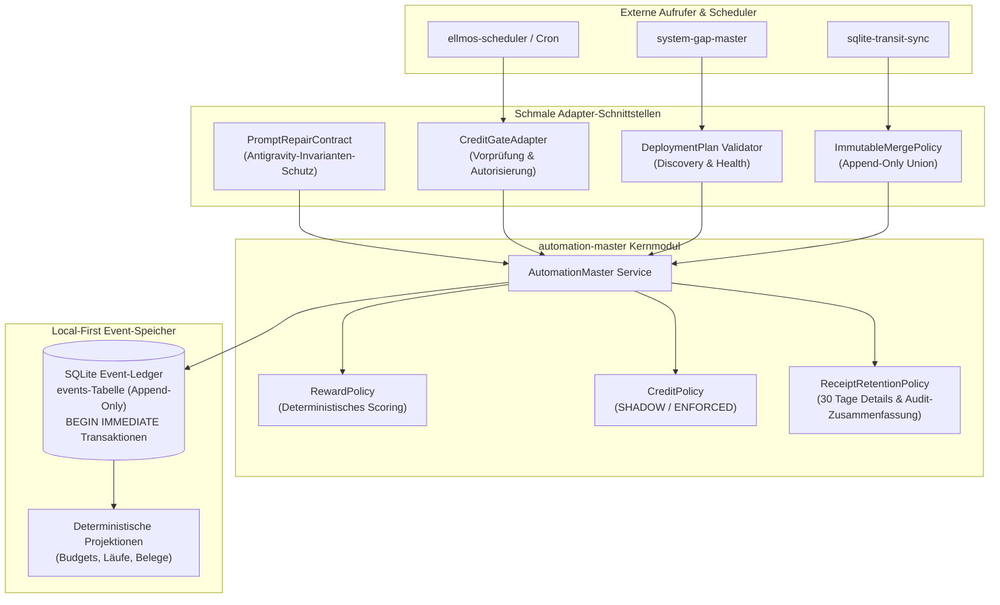
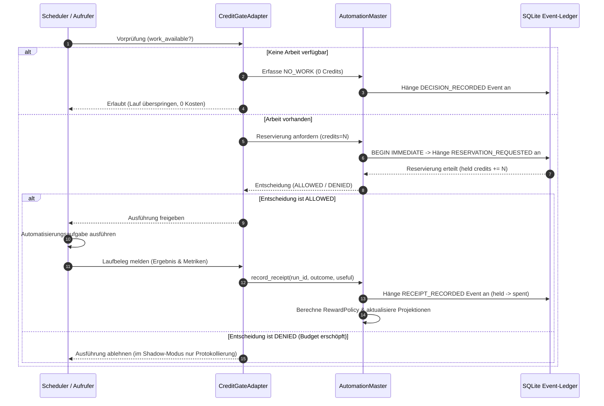
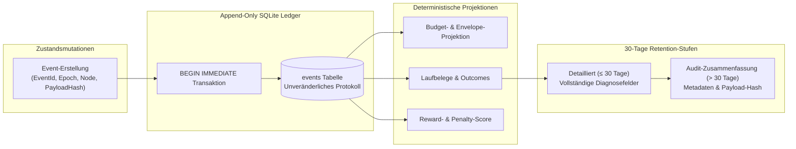

# automation-master


[](https://github.com/dev-bricks/automation-master/actions/workflows/ci.yml)
[](pyproject.toml)
[](https://github.com/astral-sh/ruff)
[](https://pytest.org)
[](https://www.python.org)
[](ARCHITECTURE.md)
[](pyproject.toml)
[](SECURITY.md)
[](SECURITY.md)
[](SECURITY.md)
[](LICENSE)
[](https://github.com/dev-bricks)
[](https://github.com/open-bricks)
[](llms.txt)

> [!NOTE]
> Schneller Index für LLMs und KI-Agenten: siehe [llms.txt](llms.txt) für Kontext, Grenzen und API-Signaturen.
> English documentation available: See [README.md](README.md).

---

### Schnellnavigation
- [1. Übersicht & Management Summary](#übersicht--management-summary)
- [2. Systemarchitektur](#systemarchitektur)
- [3. Reservierungs- & Credit-Governance-Ablauf](#reservierungs--credit-governance-ablauf)
- [4. Event-Sourcing- & Projektionslebenszyklus](#event-sourcing--projektionslebenszyklus)
- [5. Sicherheitsmodell & Governance-Invarianten](#sicherheitsmodell--governance-invarianten)
- [6. Installation & Voraussetzungen](#installation--voraussetzungen)
- [7. CLI-Bedienung & Betrieb](#cli-bedienung--betrieb)
- [8. Python-API-Integration](#python-api-integration)
- [9. Datenspeicher & Multi-OS-Pfade](#datenspeicher--multi-os-pfade)
- [10. Geschwisterwerkzeuge & Ökosystem-Matrix](#geschwisterwerkzeuge--ökosystem-matrix)
- [11. Architekturdokumente & Vertragsspezifikationen](#architekturdokumente--vertragsspezifikationen)
- [12. Sicherheitsrichtlinie & Meldewege](#sicherheitsrichtlinie--meldewege)
- [13. Lizenz](#lizenz)
- [14. Englische Dokumentation / English Version (README.md)](README.md)

---

## Übersicht & Management Summary

`automation-master` ist ein standardmäßig privates, lokal betriebenes
Control- und Governance-Modul für wiederkehrende Automatisierungsfamilien. Es erfasst
Automatisierungsvarianten, berechnet erklärbare Belohnungswerte (Reward Scores),
vergibt epochenspezifische Credit-Rahmen und protokolliert unveränderliche Laufbelege.

Das Modul plant oder startet **keine** Prozesse und ersetzt weder `task-master`
noch `ticket-master`. Die Anbindung an externe Scheduler (wie `ellmos-scheduler`), `system-gap-master`
und `sqlite-transit-sync` erfolgt über schmale, fail-closed Adapter-Schnittstellen.

---

## Systemarchitektur



---

## Reservierungs- & Credit-Governance-Ablauf



---

## Event-Sourcing & Projektions-Lebenszyklus



---

## Sicherheitsmodell & Governance-Invarianten

Das Governance-Modell von `automation-master` basiert auf zehn überprüfbaren Kerninvarianten:

| Invariante & Garantie | Geltungsbereich | Mechanismus | Durchsetzung |
| :--- | :--- | :--- | :--- |
| **1. 100% Local-First & Zero-Egress** | Netzwerk & Telemetrie | 100% Offline, reine Standardbibliothek, keine externen Sockets | Keine Netzwerkaufrufe, lokale Datenisolation |
| **2. Non-Elevation (RunAsInvoker)** | Berechtigungen | Unprivilegierter Standard-Benutzermodus | Keine administrativen Rechte oder Root erforderlich |
| **3. Unveränderliches Event-Ledger** | Persistenz | Append-Only SQLite `events`-Tabelle mit SHA-256 Payload-Hashes | Keine mutierenden `UPDATE`- oder `DELETE`-Operationen |
| **4. Atomare Reservierungsintegrität** | Nebenläufigkeit | SQLite `BEGIN IMMEDIATE` Transaktionsgrenzen | Schutz vor Budget-Überbuchungen & Race Conditions |
| **5. Fail-Closed Credit Gating** | Autorisierung | Standardmodus `SHADOW` oder `DISABLED` | Explizite Richtlinienaktivierung für harte Drosselung nötig |
| **6. Null Kosten für Leerläufe (NO_WORK)** | Budgetierung | 0 Credits bei `NO_WORK`, sofortige Freigabe reservierter Mittel | Keine Budgeterschöpfung bei Leerläufen |
| **7. Ausnahme-Garantie für Schutzläufe** | Betriebssicherheit & SLA | Garantierte Mindestabdeckung für geschäftskritische Jobs | Schutz vor Deadlines & Systemstillstand |
| **8. 30-Tage Belegaufbewahrung** | Datenlebenszyklus | 30 Tage Detailprojektion, danach unveränderliche Audit-Summen | Deterministische Alterung ohne Ledger-Mutation |
| **9. Multi-OS Plattform-Parität** | Portabilität | Identisches Laufzeitverhalten auf Windows, Linux und macOS | Pfadagnostische Standardisierung, UTF-8 |
| **10. Cloud-Sync-Ordner-Isolation** | Speichersicherheit | Datenbankablage in `%LOCALAPPDATA%` bzw. `$XDG_STATE_HOME` | Ausschluss aus synchronisierten Ordnern (OneDrive/Dropbox) |

---

## Installation & Voraussetzungen

### Voraussetzungen
- Python 3.10, 3.11, 3.12 oder 3.13
- SQLite 3.35+ (in Standard-Python enthalten)

### Installation

```powershell
python -m pip install -e ".[dev]"
```

---

## CLI-Bedienung & Betrieb

```powershell
# Lokales Event-Ledger initialisieren
automation-master --db .\pilot.db --node workstation init

# Automatisierungsfamilie registrieren
automation-master --db .\pilot.db --node workstation register-family research "Research Pipeline"

# Epochen-Budget zuweisen
automation-master --db .\pilot.db --node workstation allocate 2026-W34 research 8 seed-1

# Status und Budgetverbrauch abfragen
automation-master --db .\pilot.db --node workstation status --epoch 2026-W34 --scope research
```

---

## Python-API-Integration

```python
from automation_master import EnforcementMode, EventStore, RunClass
from automation_master.adapters import CreditGateAdapter
from automation_master.service import AutomationMaster, CreditPolicy

# Service und lokalen Event-Store initialisieren
master = AutomationMaster(EventStore("pilot.db"), node_id="workstation")

# Epochen-Kreditrahmen zuweisen
master.allocate_budget(
    budget_epoch="2026-W34",
    scope_id="research",
    credits=8,
    allocation_id="seed-1",
)

# Credit-Gate-Adapter im Shadow-Modus konfigurieren
gate = CreditGateAdapter(
    master,
    CreditPolicy(mode=EnforcementMode.SHADOW, overdraft_limit=2),
)

# Eingehenden Automatisierungslauf autorisieren
decision = gate.authorize(
    run_id="run-1",
    budget_epoch="2026-W34",
    scope_id="research",
    work_item_id="paper-1",
    work_available=True,
    credits=1,
    run_class=RunClass.COMPARABLE,
)
```

---

## Datenspeicher & Multi-OS-Pfade

> [!TIP]
> Die Produktionsdatenbank liegt isoliert außerhalb synchronisierter Cloud-Ordner (wie OneDrive oder Dropbox):
> - **Windows**: `%LOCALAPPDATA%\ellmos\automation-master\automation-master.db`
> - **Linux/macOS**: `$XDG_STATE_HOME/ellmos/automation-master/automation-master.db` (Standard: `~/.local/state/ellmos/automation-master/`)

---

## Geschwisterwerkzeuge & Ökosystem-Matrix

`automation-master` ist Teil des **dev-bricks** Ökosystems und der **open-bricks** Open-Source-Initiative:

| Projekt | Organisation | Beschreibung | Rolle in der Suite |
|---|---|---|---|
| [`DevCenter`](https://github.com/dev-bricks/DevCenter) | `dev-bricks` | Entwickler-Dashboard, Tool-Health & Systemorchestrierung | Systemmonitoring & Entwickler-Cockpit |
| [`CodeBox`](https://github.com/dev-bricks/CodeBox) | `dev-bricks` | Sandbox-Codeausführung & Skript-Runner | Sichere isolierte Laufzeitumgebung |
| [`MethodenAnalyser`](https://github.com/dev-bricks/MethodenAnalyser) | `dev-bricks` | Testmethodik & Psychometrie-Engine | Psychologische Analyse & Validierung |
| [`smart-backup`](https://github.com/dev-bricks/smart-backup) | `dev-bricks` | Lokales atomares Backup- & Snapshot-Werkzeug | Zustandssicherung & Artefakt-Recovery |
| [`win-firewall-manager`](https://github.com/dev-bricks/win-firewall-manager) | `dev-bricks` | Deklarativer Windows-Firewall-Konfigurationsmanager | Host-Sicherheit & Port-Gating |
| [`safe-start-for-codex`](https://github.com/dev-bricks/safe-start-for-codex) | `dev-bricks` | Isolierter Sandbox-Starter für Coding-Agenten | Sichere Ausführungs-Sandbox |
| [`automizer-for-claude-desktop`](https://github.com/dev-bricks/automizer-for-claude-desktop) | `dev-bricks` | Prozess-Starter & Automatisierungsbrücke für Claude Desktop | Desktop-Agenten-Orchestrierung |
| [`CareCenter-for-Codex`](https://github.com/dev-bricks/CareCenter-for-Codex) | `dev-bricks` | Klienten-Pflegedokumentation & klinischer Prozessassistent | Spezialisierter Assistenz-Workflow-Agent |
| [`companion-for-agy`](https://github.com/ellmos-ai/companion-for-agy) | `ellmos-ai` | PTY-basierter Stdout-Capture Wrapper für agy/Gemini CLI | Multi-Agent Subprozess-Orchestrierung |
| [`ellmos-scheduler`](https://github.com/ellmos-ai/ellmos-scheduler) | `ellmos-ai` | Deterministischer lokaler Aufgaben- und Job-Scheduler | Aufgabenplanung & Ausführungs-Engine |
| [`system-gap-master`](https://github.com/ellmos-ai/system-gap-master) | `ellmos-ai` | System-Paritäts- & Deploymentplan-Verifikation | Paritätsüberwachung & Health-Probes |
| [`sqlite-transit-sync`](https://github.com/ellmos-ai/sqlite-transit-sync) | `ellmos-ai` | Offline-fähige SQLite-Replikation & Synchronisation | Hostübergreifende Ledger-Synchronisation |
| [`workflowhooker-provenance`](https://github.com/ellmos-ai/workflowhooker-provenance) | `ellmos-ai` | Provenienz-Tracking & Workflow-Interceptor | Agent-Lebenszyklus-Instrumentierung |
| [`memoryhooker-provenance`](https://github.com/ellmos-ai/memoryhooker-provenance) | `ellmos-ai` | Kontext-Speicherinjektion & Provenienz-Harness | Sitzungsgedächtnis & Kontextabruf |
| [`ellmos-controlcenter-mcp`](https://github.com/ellmos-ai/ellmos-controlcenter-mcp) | `ellmos-ai` | Gateway & Tool-Orchestrierungs-MCP-Server | MCP-Werkzeug-Koordination |
| [`ellmos-filecommander-mcp`](https://github.com/ellmos-ai/ellmos-filecommander-mcp) | `ellmos-ai` | Sicherer Dateisystem-MCP-Server mit Papierkorb-Schutz | Sichere Dateioperationen |
| [`ellmos-codecommander-mcp`](https://github.com/ellmos-ai/ellmos-codecommander-mcp) | `ellmos-ai` | Code-Analyse & AST-Refactoring-MCP-Server | AST-Code-Transformation |
| [`WinStorePackager`](https://github.com/file-bricks/WinStorePackager) | `file-bricks` | MSIX-Paketierung & Windows Store Deployment-Pipeline | Desktop-App-Distribution |
| [`ProFiler`](https://github.com/file-bricks/ProFiler) | `file-bricks` | Schneller, lokaler Datei-Inspektor und Kategorisierer | Dateiorganisation & Asset-Inspektion |
| [`ExplorerPro`](https://github.com/file-bricks/ExplorerPro) | `file-bricks` | Multi-Tab Datei-Manager mit KI-Schlagworten | Dateinavigation & Indexverwaltung |
| [`DokuZen`](https://github.com/doc-bricks/DokuZen) | `doc-bricks` | Lokale Dokumentenverwaltung & Textextraktion | Dokumenten-OCR & Verschlagwortung |
| [`PDFtoPDFocr`](https://github.com/doc-bricks/PDFtoPDFocr) | `doc-bricks` | Lokales Batch-PDF-OCR Konvertierungswerkzeug | PDF-Texterkennung & Volltextindizierung |
| [`MediaBrain`](https://github.com/doc-bricks/MediaBrain) | `doc-bricks` | Lokale KI-Medienverwaltung & Transkriptions-Engine | Audio- & Video-Wissensaufbereitung |
| [`open-bricks`](https://github.com/open-bricks) | `open-bricks` | Dachorganisation für modulare Entwickler- & Desktop-Tools | Ökosystem-Dach |

---

## Architekturdokumente & Vertragsspezifikationen

- [ARCHITECTURE.md](ARCHITECTURE.md): Detaillierte Architekturschichten, Event-Schemata und Reservierungsmechanik.
- [SECURITY.md](SECURITY.md): Sicherheitsrichtlinie, Local-First-Speicher-Invarianten und Schwachstellenmeldung.
- [CHANGELOG.md](CHANGELOG.md): Versionshistorie und Discoverability-Einträge.
- [contracts/scheduler-credit-gate.md](contracts/scheduler-credit-gate.md): Schnittstellenspezifikation für den Scheduler-Credit-Gate-Adapter.
- [contracts/receipt-retention.md](contracts/receipt-retention.md): 30-Tage Belegaufbewahrung und Audit-Zusammenfassungsvertrag.
- [contracts/deployment-plan.schema.json](contracts/deployment-plan.schema.json): JSON-Schema für System-Gap-Deployment-Pläne.

---

## Sicherheitsrichtlinie & Meldewege

Für sicherheitsrelevante Hinweise und vertrauliche Anfragen:
- **Sicherheitsteam**: `security@open-bricks.org`
- **Alternativ**: `security@ellmos.ai`
- **Maintainer**: `support@lukasgeiger.com`
- **Lead Maintainer**: `lukas@open-bricks.org`
- **GitHub Security Advisories**: [Private Sicherheitsmeldung eröffnen](https://github.com/dev-bricks/automation-master/security/advisories)

### Reaktions-SLAs
- **48-Stunden-Reaktions-SLA**: Bestätigung des Eingangs jeder Sicherheitsmeldung innerhalb von maximal 48 Stunden.
- **5-Tage-Triage-Zusage**: Fachliche Triage, Risikobewertung und Schwachstellenanalyse innerhalb von 5 Werktagen.

---

## Lizenz

Dieses Projekt steht unter der [MIT-Lizenz](LICENSE).

---

## Englische Dokumentation / English Version

Die vollständige englischsprachige Dokumentation finden Sie in [README.md](README.md).
