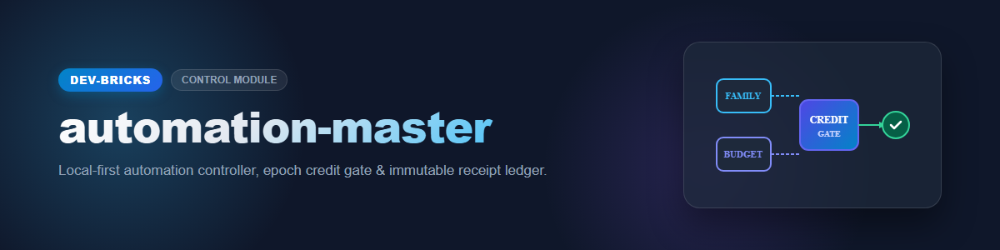
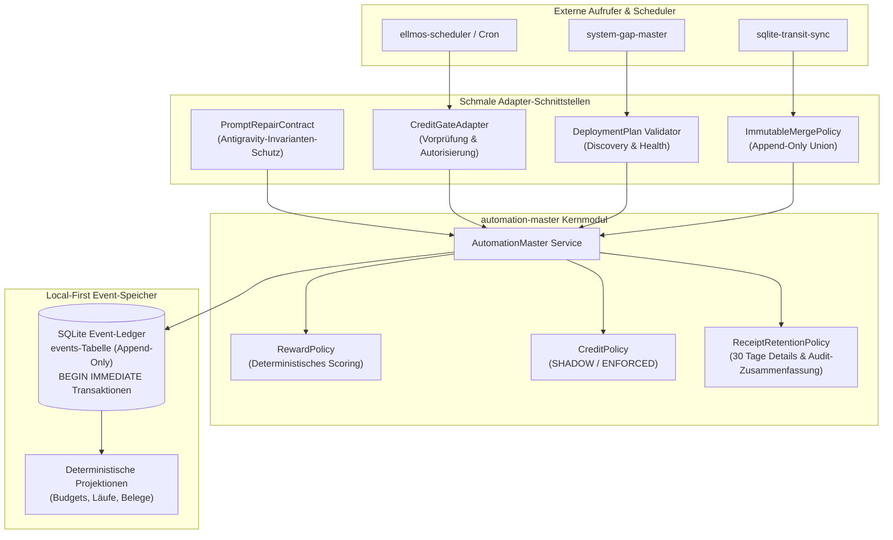
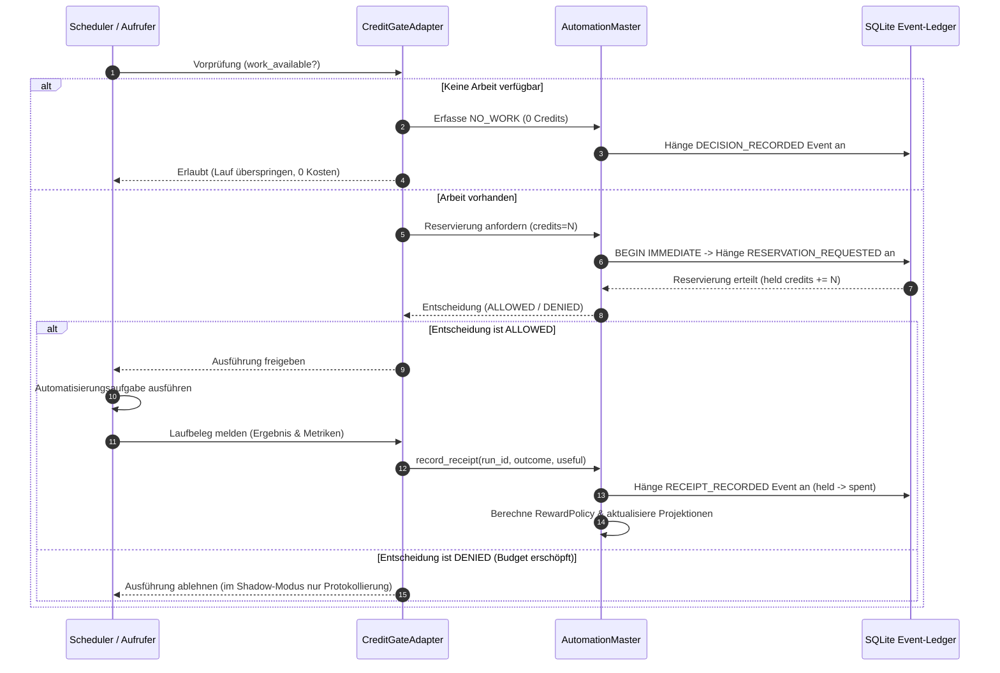

# automation-master



[](https://pytest.org)
[](https://www.python.org)
[](LICENSE)
[](https://github.com/dev-bricks)
[](https://github.com/open-bricks)
[](llms.txt)

> [!NOTE]
> Schneller Index für LLMs und KI-Agenten: siehe [llms.txt](llms.txt) für Kontext, Grenzen und API-Signaturen.

`automation-master` ist ein standardmäßig privates, lokal betriebenes
Control-Modul für wiederkehrende Automatisierungen. Es erfasst
Automatisierungsfamilien und Varianten, berechnet erklärbare Belohnungswerte,
vergibt epochenspezifische Credit-Rahmen und protokolliert Laufbelege.

Das Modul plant oder startet keine Prozesse und ersetzt weder `task-master`
noch `ticket-master`. Der Scheduler erhält nur eine schmale Vorprüfungs- und
Credit-Gate-Schnittstelle.

## Architektur



## Reservierungs- & Credit-Governance-Ablauf



## Schutzregeln

- Der Startmodus ist `disabled` oder `shadow`; harte Gates sind Opt-in.
- `NO_WORK` kostet keinen Credit. Wird erst nach der Reservierung `NO_WORK`
  festgestellt, wird die Reservierung vollständig freigegeben.
- Normale vergleichbare Läufe können bei fehlendem Guthaben abgelehnt werden.
- Einzigartige, sicherheitskritische oder fristgebundene Läufe behalten eine
  Mindestabdeckung.
- Zustandsänderungen sind unveränderliche Events. Es gibt keine veränderbare
  Saldo-Tabelle und kein Last-write-wins.
- `BEGIN IMMEDIATE` schützt Reservierungen innerhalb eines Hosts. Zwischen
  Hosts gilt Eventual Consistency; globale harte Atomarität wird nicht
  versprochen.
- System-Gap-Importe prüfen Quelle, Ziel, Manifest-Hash, Version und
  Aktivierungsmodus. Fremde Slots werden abgelehnt.
- Detaillierte Laufbelege bleiben 30 Tage in der Projektion; danach bleiben
  Event-Metadaten und der unveränderliche Payload-Hash als Audit-Zusammenfassung
  erhalten. Das Event-Ledger wird durch Retention nicht umgeschrieben.

## Schnellstart

```powershell
python -m pip install -e ".[dev]"
automation-master --db .\pilot.db --node workstation init
automation-master --db .\pilot.db --node workstation register-family research "Research"
automation-master --db .\pilot.db --node workstation allocate 2026-W31 research 8 seed-1
automation-master --db .\pilot.db --node workstation status --epoch 2026-W31 --scope research
```

Die Standarddatenbank liegt außerhalb synchronisierter Ordner unter
`%LOCALAPPDATA%\ellmos\automation-master\automation-master.db`.

## Ökosystem & Verwandte Werkzeuge

`automation-master` ist Teil des **dev-bricks** Ökosystems und der **open-bricks** Open-Source-Initiative:

| Projekt | Beschreibung | Rolle in der Suite |
|---|---|---|
| [`DevCenter`](https://github.com/dev-bricks/DevCenter) | Entwickler-Dashboard, Tool-Health & Systemorchestrierung | Systemmonitoring & Entwickler-Cockpit |
| [`CodeBox`](https://github.com/dev-bricks/CodeBox) | Sandbox-Codeausführung & Skript-Runner | Sichere isolierte Laufzeitumgebung |
| [`MethodenAnalyser`](https://github.com/dev-bricks/MethodenAnalyser) | Testmethodik & Psychometrie-Engine | Psychologische Analyse & Validierung |
| [`companion-for-agy`](https://github.com/ellmos-ai/companion-for-agy) | PTY-basierter Stdout-Capture Wrapper für agy/Gemini CLI | Multi-Agent Subprozess-Orchestrierung |
| [`CareCenter-for-Codex`](https://github.com/dev-bricks/CareCenter-for-Codex) | Klienten-Pflegedokumentation & klinischer Prozessassistent | Spezialisierter Assistenz-Workflow-Agent |

