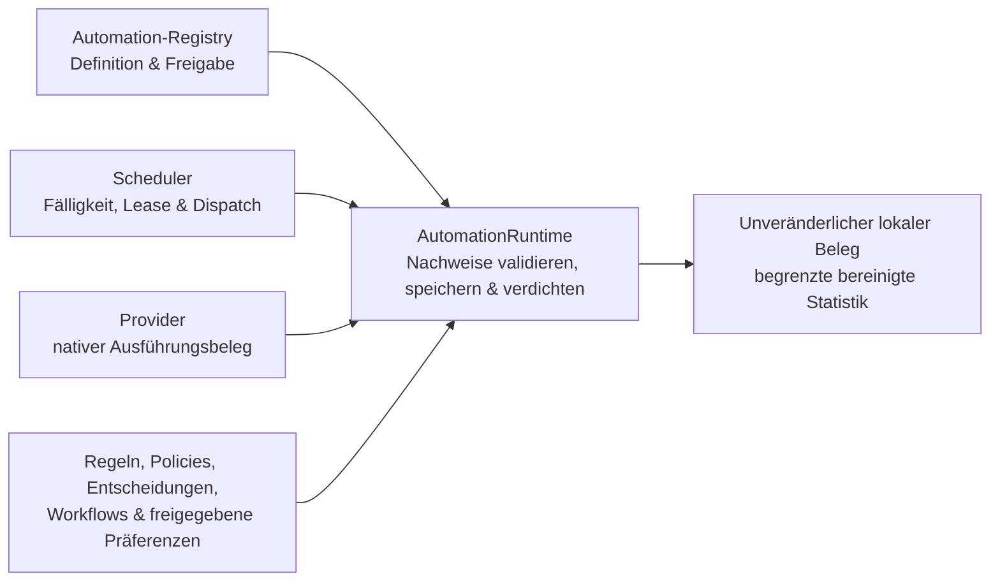
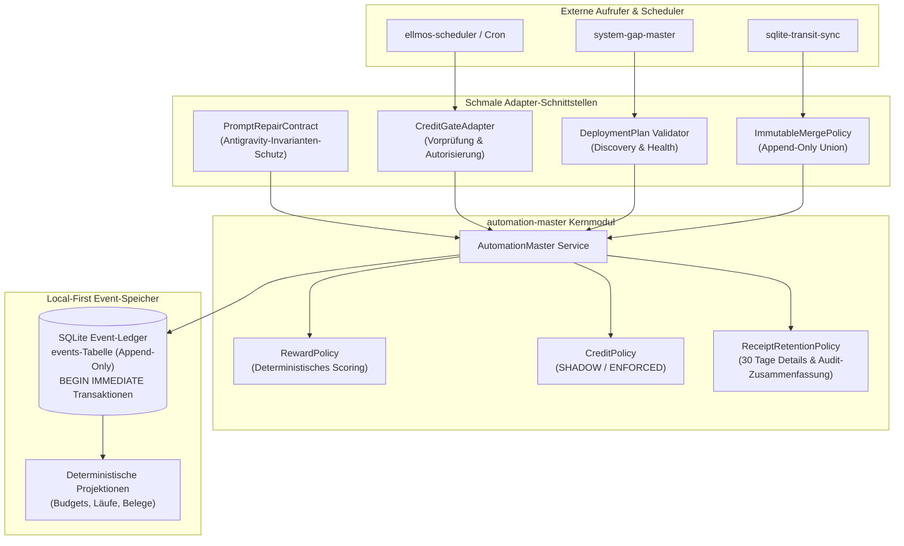
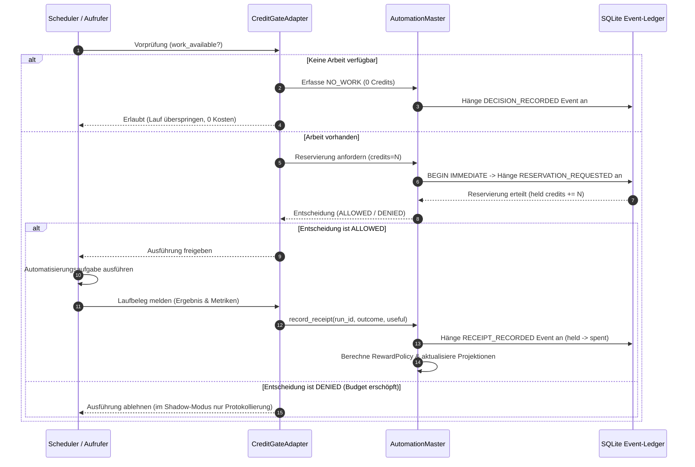
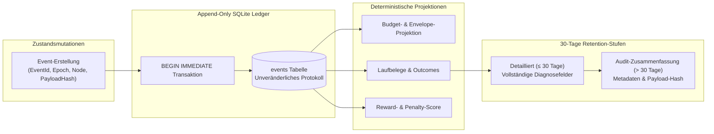

# automation-master


[](https://github.com/dev-bricks/automation-master/actions/workflows/ci.yml)
[](https://pytest.org)
[](pyproject.toml)
[](https://www.python.org)
[](ARCHITECTURE.md)
[](pyproject.toml)
[](SECURITY.md)
[](SECURITY.md)
[](LICENSE)
[](https://github.com/dev-bricks)
[](https://github.com/open-bricks)
[](llms.txt)

> [!NOTE]
> Schneller Index für LLMs und KI-Agenten: siehe [llms.txt](llms.txt) für Kontext, Grenzen und API-Signaturen.

`automation-master` ist ein standardmäßig privates, lokal betriebenes
Control- und Governance-Modul für wiederkehrende Automatisierungsfamilien. Es erfasst
Automatisierungsvarianten, berechnet erklärbare Belohnungswerte (Reward Scores),
vergibt epochenspezifische Credit-Rahmen und protokolliert unveränderliche Laufbelege.

Das Paket stellt außerdem `AutomationRuntime` als getrennten logischen
Runtime-Beobachter bereit. Er validiert native Rücklesedaten von Provider und
Scheduler, speichert unveränderliche bereinigte Laufbelege und meldet begrenzte
Runtime-Statistiken, ohne Definitions-, Planungs- oder Policy-Autorität zu
beanspruchen.

Das Modul plant oder startet **keine** Prozesse und ersetzt weder `task-master`
noch `ticket-master`. Die Anbindung an externe Scheduler (wie `ellmos-scheduler`), `system-gap-master`
und `sqlite-transit-sync` erfolgt über schmale, fail-closed Adapter-Schnittstellen.

## Versions- und Auslieferungsstatus

- Basispaket, Manifest und der Remote-Branch `main` weisen die Version **0.1.1** aus.
- Für 0.1.1 existiert weder ein Git-Tag noch ein GitHub-Release; die Nummer bezeichnet den
  Repository- und Paketmetadatenstand, keine extern veröffentlichte Version.
- `AutomationRuntime` ist ausschließlich auf dem Branch
  `feat/automation-runtime-observer-20260829` implementiert und bleibt **Unreleased**, bis PR, CI,
  Review und die endgültige Versionsentscheidung abgeschlossen sind. Der Observer ist nicht in
  `main` integriert.
- Das Modul bleibt **experimentell** und **privat**. Enforcement ist standardmäßig deaktiviert;
  derzeit sind ausschließlich synthetische und Shadow-Piloten erlaubt. Veröffentlichung und reale
  Scheduler-Aktivierung sind nicht autorisiert.

## Grenze der Runtime-Beobachtung



Der Beobachter akzeptiert ein geschlossenes Belegschema und verlangt native
Rücklesedaten sowohl vom Provider als auch vom Scheduler. Nicht app-eigene
Ausführungen benötigen einen unveränderlichen Commit- oder Inhalts-Pin. Der
Belegspeicher schreibt nur neue Dateien, erkennt Manipulationen und verweigert
konfigurierte OneDrive-Verzeichnisse. Provider- und Scheduler-Leser geben nur
begrenzte gehashte Metadaten zurück; Roh-Prompts, Ausgaben, Fehler,
Zugangsdaten und Quellpfade überschreiten diese Grenze nicht.

Die Runtime-Beobachtung plant, startet, genehmigt, verändert, veröffentlicht
oder erzwingt keine Automation. Siehe den deutschsprachigen
[Runtime-Beobachtungsvertrag](contracts/automation-runtime-observation_de.md).

---

## Architektur



---

## Reservierungs- & Credit-Governance-Ablauf



---

## Event-Sourcing & Projektions-Lebenszyklus



---

## Schutzregeln & Governance-Invarianten

- **Standardmäßig Fail-Closed**: Der Startmodus ist `disabled` oder `shadow`; harte Gates sind Opt-in und erfordern explizite Aktivierung.
- **Null Kosten für inaktive Läufe**: `NO_WORK` in der Vorprüfung kostet 0 Credits. Wird erst nach der Reservierung `NO_WORK` festgestellt, wird die Reservierung vollständig freigegeben.
- **Ausnahme-Garantie für Schutzläufe**: Einzigartige, sicherheitskritische oder fristgebundene Läufe behalten eine garantierte Mindestabdeckung.
- **Unveränderliches Event-Ledger**: Jede dauerhafte Zustandsänderung ist ein unveränderliches Event mit Event-ID, Node-ID, Budget-Epoche, Entity-Version und SHA-256 Payload-Hash.
- **Transaktions-Isolation**: Lokale Reservierungen nutzen atomare `BEGIN IMMEDIATE` SQLite-Transaktionen; hostübergreifende Synchronisation erfolgt mit Eventual Consistency.
- **Zero-Egress & Geheimnis-Schutz**: Roh-Payloads und Zugangsdatenmuster werden niemals exportiert oder übertragen.
- **Beleg-Retention**: Detaillierte Laufbelege bleiben 30 Tage erhalten; danach sichern Audit-Zusammenfassungen mit Hashes die dauerhafte Integrität.

---

## Schnellstart

### Installation

```powershell
python -m pip install -e ".[dev]"
```

### CLI-Nutzung

```powershell
# Lokales Event-Ledger initialisieren
automation-master --db .\pilot.db --node workstation init

# Automatisierungsfamilie registrieren
automation-master --db .\pilot.db --node workstation register-family research "Research Pipeline"

# Epochen-Budget zuweisen
automation-master --db .\pilot.db --node workstation allocate 2026-W34 research 8 seed-1

# Status und Budgetverbrauch abfragen
automation-master --db .\pilot.db --node workstation status --epoch 2026-W34 --scope research

# Bereinigte Metadaten aus nativen Provider- und Scheduler-Nachweisen ableiten
automation-master runtime-provider-readback .\provider-beleg.json --source-id provider-a
automation-master runtime-scheduler-readback .\scheduler-snapshot.db run-123

# Validierten Runtime-Beleg unveränderlich speichern und begrenzte Statistik ausgeben
automation-master --receipts-dir .\runtime-belege runtime-record .\beleg.json
automation-master --receipts-dir .\runtime-belege runtime-stats
```

> [!TIP]
> Die Produktionsdatenbank liegt isoliert außerhalb synchronisierter Cloud-Ordner:
> - **Windows**: `%LOCALAPPDATA%\ellmos\automation-master\automation-master.db`
> - **Linux/macOS**: `$XDG_STATE_HOME/ellmos/automation-master/automation-master.db`

### Python-API-Beispiel

```python
from automation_master import EnforcementMode, EventStore, RunClass
from automation_master.adapters import CreditGateAdapter
from automation_master.service import AutomationMaster, CreditPolicy

# Service und lokalen Event-Store initialisieren
master = AutomationMaster(EventStore("pilot.db"), node_id="workstation")

# Epochen-Kreditrahmen zuweisen
master.allocate_budget(
    budget_epoch="2026-W34",
    scope_id="research",
    credits=8,
    allocation_id="seed-1",
)

# Credit-Gate-Adapter im Shadow-Modus konfigurieren
gate = CreditGateAdapter(
    master,
    CreditPolicy(mode=EnforcementMode.SHADOW, overdraft_limit=2),
)

# Eingehenden Automatisierungslauf autorisieren
decision = gate.authorize(
    run_id="run-1",
    budget_epoch="2026-W34",
    scope_id="research",
    work_item_id="paper-1",
    work_available=True,
    credits=1,
    run_class=RunClass.COMPARABLE,
)
```

---

## Ökosystem & Verwandte Werkzeuge

`automation-master` ist Teil des **dev-bricks** Ökosystems und der **open-bricks** Open-Source-Initiative:

| Projekt | Organisation | Beschreibung | Rolle in der Suite |
|---|---|---|---|
| [`DevCenter`](https://github.com/dev-bricks/DevCenter) | `dev-bricks` | Entwickler-Dashboard, Tool-Health & Systemorchestrierung | Systemmonitoring & Entwickler-Cockpit |
| [`CodeBox`](https://github.com/dev-bricks/CodeBox) | `dev-bricks` | Sandbox-Codeausführung & Skript-Runner | Sichere isolierte Laufzeitumgebung |
| [`MethodenAnalyser`](https://github.com/dev-bricks/MethodenAnalyser) | `dev-bricks` | Testmethodik & Psychometrie-Engine | Psychologische Analyse & Validierung |
| [`companion-for-agy`](https://github.com/ellmos-ai/companion-for-agy) | `ellmos-ai` | PTY-basierter Stdout-Capture Wrapper für agy/Gemini CLI | Multi-Agent Subprozess-Orchestrierung |
| [`safe-start-for-codex`](https://github.com/dev-bricks/safe-start-for-codex) | `dev-bricks` | Isolierter Sandbox-Starter für Coding-Agenten | Sichere Ausführungs-Sandbox |
| [`automizer-for-claude-desktop`](https://github.com/dev-bricks/automizer-for-claude-desktop) | `dev-bricks` | Prozess-Starter & Automatisierungsbrücke für Claude Desktop | Desktop-Agenten-Orchestrierung |
| [`CareCenter-for-Codex`](https://github.com/dev-bricks/CareCenter-for-Codex) | `dev-bricks` | Klienten-Pflegedokumentation & klinischer Prozessassistent | Spezialisierter Assistenz-Workflow-Agent |
| [`WinStorePackager`](https://github.com/file-bricks/WinStorePackager) | `file-bricks` | MSIX-Paketierung & Windows Store Deployment-Pipeline | Desktop-App-Distribution |
| [`ProFiler`](https://github.com/file-bricks/ProFiler) | `file-bricks` | Schneller, lokaler Datei-Inspektor und Kategorisierer | Dateiorganisation & Asset-Inspektion |
| [`ExplorerPro`](https://github.com/file-bricks/ExplorerPro) | `file-bricks` | Multi-Tab Datei-Manager mit KI-Schlagworten | Dateinavigation & Indexverwaltung |
| [`DokuZen`](https://github.com/doc-bricks/DokuZen) | `doc-bricks` | Lokale Dokumentenverwaltung & Textextraktion | Dokumenten-OCR & Verschlagwortung |
| [`PDFtoPDFocr`](https://github.com/doc-bricks/PDFtoPDFocr) | `doc-bricks` | Lokales Batch-PDF-OCR Konvertierungswerkzeug | PDF-Texterkennung & Volltextindizierung |
| [`MediaBrain`](https://github.com/doc-bricks/MediaBrain) | `doc-bricks` | Lokale KI-Medienverwaltung & Transkriptions-Engine | Audio- & Video-Wissensaufbereitung |
| [`ellmos-controlcenter-mcp`](https://github.com/ellmos-ai/ellmos-controlcenter-mcp) | `ellmos-ai` | Gateway & Tool-Orchestrierungs-MCP-Server | MCP-Werkzeug-Koordination |
| [`ellmos-filecommander-mcp`](https://github.com/ellmos-ai/ellmos-filecommander-mcp) | `ellmos-ai` | Sicherer Dateisystem-MCP-Server mit Papierkorb-Schutz | Sichere Dateioperationen |
| [`ellmos-codecommander-mcp`](https://github.com/ellmos-ai/ellmos-codecommander-mcp) | `ellmos-ai` | Code-Analyse & AST-Refactoring-MCP-Server | AST-Code-Transformation |
| [`open-bricks`](https://github.com/open-bricks) | `open-bricks` | Dachorganisation für modulare Entwickler- & Desktop-Tools | Ökosystem-Dach |

---

## Dokumentation & Schnittstellenverträge

- [ARCHITECTURE.md](ARCHITECTURE.md): Detaillierte Architekturschichten, Event-Schemata und Reservierungsmechanik.
- [SECURITY.md](SECURITY.md): Sicherheitsrichtlinie, Local-First-Speicher-Invarianten und Schwachstellenmeldung.
- [CHANGELOG.md](CHANGELOG.md): Versionshistorie und Discoverability-Einträge.
- [contracts/scheduler-credit-gate.md](contracts/scheduler-credit-gate.md): Schnittstellenspezifikation für den Scheduler-Credit-Gate-Adapter.
- [contracts/receipt-retention.md](contracts/receipt-retention.md): 30-Tage Belegaufbewahrung und Audit-Zusammenfassungsvertrag.
- [contracts/automation-runtime-observation_de.md](contracts/automation-runtime-observation_de.md): Deutsche Grenzen für Runtime-Rücklesen, unveränderliche Belege, Autoritätsauflösung und Zuständigkeiten.
- [contracts/deployment-plan.schema.json](contracts/deployment-plan.schema.json): JSON-Schema für System-Gap-Deployment-Pläne.

---

## Sicherheit & Kontakt

Für sicherheitsrelevante Hinweise und vertrauliche Anfragen:
- **Sicherheitsteam**: `security@ellmos.ai`
- **Maintainer**: `support@lukasgeiger.com`

---

## Lizenz

Dieses Projekt steht unter der [MIT-Lizenz](LICENSE).
