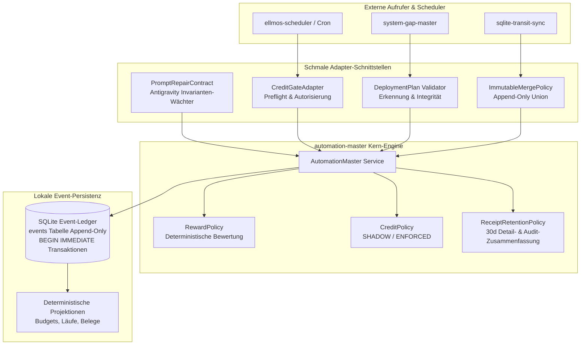
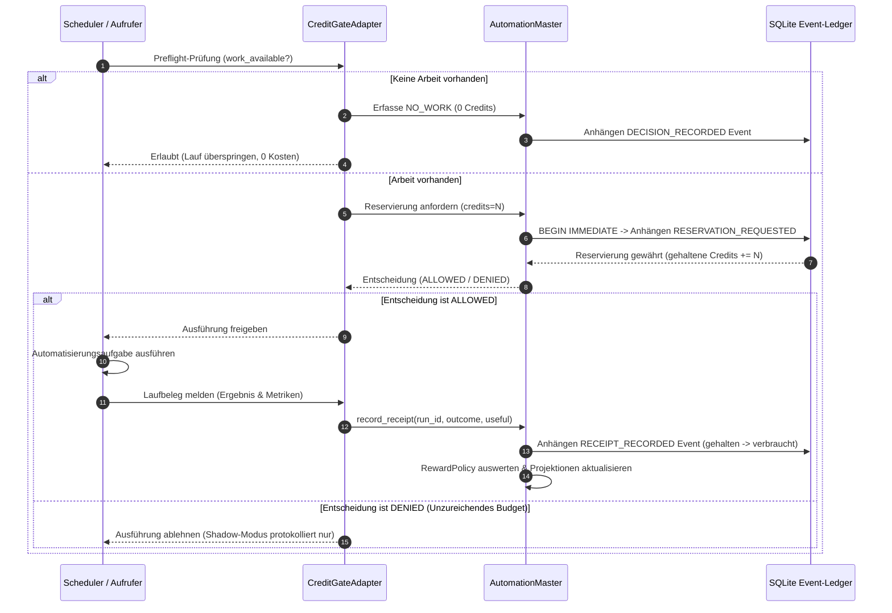
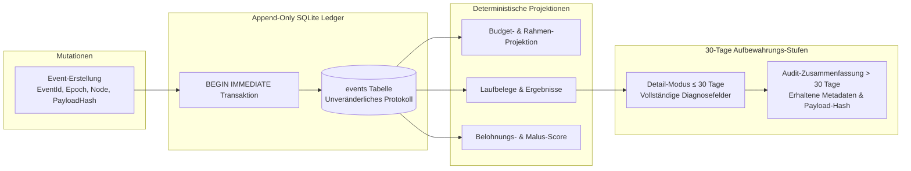

# automation-master


[](https://github.com/dev-bricks/automation-master/actions/workflows/ci.yml)
[](pyproject.toml)
[](https://github.com/astral-sh/ruff)
[](https://pytest.org)
[](https://www.python.org)
[](ARCHITECTURE.md)
[](pyproject.toml)
[](SECURITY.md)
[](SECURITY.md)
[](SECURITY.md)
[](THIRD_PARTY_LICENSES.md)
[](THIRD_PARTY_LICENSES.md)
[](NOTICE)
[](MARKETING-LOG.txt)
[](LICENSE)
[](https://github.com/dev-bricks)
[](https://github.com/open-bricks)
[](llms.txt)

> [!NOTE]
> Schneller Index für LLMs und KI-Agenten: siehe [llms.txt](llms.txt) für Kontext, Grenzen und API-Signaturen.
> English documentation available: See [README.md](README.md).

---

### Schnellnavigation
- [1. Übersicht & Management Summary](#1-uebersicht--management-summary)
- [2. Visuelle Systemarchitektur & Topologie](#2-visuelle-systemarchitektur--topologie)
- [3. End-to-End Governance- & Credit-Lebenszyklus](#3-end-to-end-governance--credit-lebenszyklus)
- [4. Zielgruppen & High-Intent Suchbegriffe](#4-zielgruppen--high-intent-suchbegriffe)
- [5. Vergleichsmatrix gegenüber Alternativen](#5-vergleichsmatrix-gegenueber-alternativen)
- [6. Governance- & Laufzeit-Invarianten-Matrix](#6-governance--laufzeit-invarianten-matrix)
- [7. Event-Sourcing- & Projektionslebenszyklus](#7-event-sourcing--projektionslebenszyklus)
- [8. Installation & Voraussetzungen](#8-installation--voraussetzungen)
- [9. CLI-Bedienung & Betrieb](#9-cli-bedienung--betrieb)
- [10. Python-API-Integration & Erweiterungspunkte](#10-python-api-integration--erweiterungspunkte)
- [11. Datenspeicher & Multi-OS-Pfade](#11-datenspeicher--multi-os-pfade)
- [12. Architekturdokumente & Vertragsspezifikationen](#12-architekturdokumente--vertragsspezifikationen)
- [13. Geschwisterwerkzeuge & Ökosystem-Matrix](#13-geschwisterwerkzeuge--oekosystem-matrix)
- [14. Testen, Verifikation & Qualitäts-Gates](#14-testen-verifikation--qualitaets-gates)
- [15. Sicherheitsrichtlinie & Meldewege (48h Antwort-SLA)](#15-sicherheitsrichtlinie--meldewege-48h-antwort-sla)
- [16. Drittanbieter-Lizenzen & Level 1 SBOM](#16-drittanbieter-lizenzen--level-1-sbom)
- [17. Entdeckungs-Schlüsselwörter & KI-Agenten-Index](#17-entdeckungs-schluesselwoerter--ki-agenten-index)
- [18. Gesetzliche Hinweise, Haftungsbeschränkung & Lizenz (§ 521 BGB)](#18-gesetzliche-hinweise-haftungsbeschraenkung--lizenz--521-bgb)

---

## <a id="1-uebersicht--management-summary"></a><a id="uebersicht--management-summary"></a><a id="executive-summary--core-identity"></a><a id="executive-summary"></a>1. Übersicht & Management Summary

`automation-master` ist ein standardmäßig privates, lokal betriebenes Control- und Governance-Modul für wiederkehrende Automatisierungsfamilien und Multi-Agenten-KI-Pipelines. Es erfasst Automatisierungsvarianten, berechnet erklärbare Belohnungswerte (Reward Scores), verwaltet epochenspezifische Credit-Rahmen, protokolliert unveränderliche Laufbelege und schlägt Drosselungsentscheidungen vor.

Das Modul plant oder startet **keine** Prozesse und ersetzt weder `task-master`, `ticket-master` noch `ellmos-scheduler`. Stattdessen stellt es deterministische Policy-Governance und Zulassungskontrolle über schmale, fail-closed Adapter-Schnittstellen bereit.

---

## <a id="2-visuelle-systemarchitektur--topologie"></a><a id="visuelle-systemarchitektur--topologie"></a><a id="systemarchitektur"></a><a id="visual-architecture--system-topology"></a>2. Visuelle Systemarchitektur & Topologie

Das nachfolgende Diagramm veranschaulicht die entkoppelten Architekturschichten von externen Aufrufern über Adapterschnittstellen, Governance-Kerne bis zur lokalen Persistenz:



---

## <a id="3-end-to-end-governance--credit-lebenszyklus"></a><a id="end-to-end-governance--credit-lebenszyklus"></a><a id="reservierungs--credit-governance-ablauf"></a><a id="end-to-end-governance--credit-lifecycle"></a>3. End-to-End Governance- & Credit-Lebenszyklus



---

## <a id="4-zielgruppen--high-intent-suchbegriffe"></a><a id="zielgruppen--high-intent-suchbegriffe"></a><a id="zielgruppen--auffindbarkeit"></a><a id="target-personas--high-intent-seo-queries"></a>4. Zielgruppen & High-Intent Suchbegriffe

`automation-master` ist auf vier primäre Zielgruppen und Betriebsszenarien zugeschnitten:

- **`[PERSONA-01]` Autonome KI-Agenten-Entwickler & Schwarm-Operatoren**: Verhindert unkontrollierte Endlosschleifen, Token-Burn und ausufernde Tool-Aufruf-Kosten in Multi-Agenten-Umgebungen (Claude Code, Antigravity, Codex, Kimi). Bietet deterministische Credit-Reservierungen und nachvollziehbare Belohnungsdegradierung.
- **`[PERSONA-02]` DevOps-, SRE- & CI/CD-Pipeline-Architekten**: Ersetzt fragile Crontabs und unüberwachte Hintergrundskripte durch epochenspezifische Budgets, Vorab-`NO_WORK`-Prüfungen (0 verbrauchte Credits) und revisionssichere Event-Ledger.
- **`[PERSONA-03]` Edge-, Embedded- & Air-Gapped-Systementwickler**: Zuverlässige, abhängigkeitsfreie Prozesssteuerung auf isolierten Arbeitsstationen oder Offline-Geräten ohne externe Daemon-Anforderungen, Cloud-Dienste oder Netzwerk-Egress (`INV-LOCAL-01`).
- **`[PERSONA-04]` Unternehmens-Sicherheits- & Compliance-Verantwortliche**: Kryptographisch nachweisbare Aufgaben-Herkunft, Ressourcennutzung und Entscheidungsgründe über Append-Only-SQLite-Ledger mit SHA-256-Payload-Hashing (`INV-IMMUT-03`), abgesichert durch ein formales 48h-Sicherheits-SLA (`INV-ISOLAT-10`).

### High-Intent Suchbegriffe

| Sprache | Suchbegriff | Primäre Absicht / Zielgruppe |
| :--- | :--- | :--- |
| **DE** | `automation-master lokale Automatisierungs-Governance` | Deutsche Identität & Paketdokumentation |
| **DE** | `KI-Agent Aufgaben-Drosselung Belohnungsmodell` | KI-Agenten Throttling und Belohnungssteuerung `[PERSONA-01]` |
| **DE** | `Event-Sourced Credit Budget SQLite Python` | Lokale Budgetierung und Event-Sourcing `[PERSONA-02]` |
| **DE** | `Lokale Prozess-Governance ohne Cloud-Abhängigkeit` | Cloud-unabhängige Prozessüberwachung `[PERSONA-03]` |
| **DE** | `Zero-Egress Task Governance Python` | Offline-Betrieb & Datenschutz `[PERSONA-04]` |
| **EN** | `automation-master` | Kanonische Repository- und Dokumentationssuche |
| **EN** | `local-first automation governance python` | Lokales Governance-Framework `[PERSONA-02]` |
| **EN** | `event-sourced credit budget sqlite` | Event-Ledger & Credit-Reservierung `[PERSONA-01]` |
| **EN** | `ai agent task throttling and reward policy` | Multi-Agenten-Drosselung & Bewertung `[PERSONA-01]` |
| **EN** | `zero-egress task governance python` | Air-Gapped Ausführung `[PERSONA-03]` |

---

## <a id="5-vergleichsmatrix-gegenueber-alternativen"></a><a id="vergleichsmatrix-gegenueber-alternativen"></a><a id="comparative-matrix-vs-alternatives"></a>5. Vergleichsmatrix gegenüber Alternativen

Die folgende Matrix vergleicht `automation-master` über 10 architektonische und governance-spezifische Dimensionen mit 4 verbreiteten Alternativen:

| Technische Dimension | automation-master | Klassische Scheduler (cron/systemd) | Workflow-Engines (Airflow/Prefect) | Cloud SaaS FinOps (AWS Budgets) | Ad-hoc Shell-Skripte & Locks |
| :--- | :--- | :--- | :--- | :--- | :--- |
| **Local-First & Zero-Egress** | **100% Local-First** (`INV-LOCAL-01`) | Lokaler Betriebssystem-Prozess | Schwerfälliger Multi-Container-Stack | ❌ Zwingende Cloud-Telemetrie | Lokales Skript |
| **Laufzeit-Abhängigkeiten** | **Null Basis-Abhängigkeiten** (`dependencies = []`) | OS-native Binaries | 50+ schwere Abhängigkeiten (Postgres/Redis) | Umfassende Vendor-SDKs | Minimal |
| **Governance & Credit-Rahmen** | **Epochen-Rahmen & Scopes** | ❌ Keine (läuft bedingungslos) | Einfache Concurrency-Slots | Reine Cloud-Abrechnungsquoten | ⚠️ Flüchtige Zähler |
| **Event-Sourcing & Immutabilität** | **Append-Only SQLite + SHA-256** (`INV-IMMUT-03`) | ❌ Flüchtiges Syslog | Veränderbare Datenbanktabellen | SaaS-Auditlogs (Remote) | ❌ Keine |
| **Atomare Reservierung & Überziehung**| **Atomares `BEGIN IMMEDIATE`** (`INV-ATOMIC-04`) | ❌ Race-Condition-anfällig | Verteiltes Locking erforderlich | Cloud-API-Ratenbegrenzung | ❌ Datei-Races |
| **Belohnungs- & Scoring-Modell** | **Erklärbares Scoring & Decay** | ❌ Keine | ❌ Keine | ❌ Keine | ❌ Keine |
| **Kostenfreie Leerläufe** | **0 Credits für `NO_WORK`** (`INV-NOWORK-06`) | ❌ Vollständiger Lauf gestartet | ⚠️ Worker-Slot belegt | ❌ API-Aufruf abgerechnet | ❌ Manuelle Prüfung |
| **Multi-Host-Konvergenz** | **Offline-Sync via `sqlite-transit-sync`** | ❌ Host-isoliert | Zentrale DB erforderlich | Zentrale Cloud-Steuerungsebene | ❌ Host-isoliert |
| **Rechtemodell** | **Unprivilegiert `RunAsInvoker`** (`INV-PRIV-02`) | Häufig root / root crontab | Service-Account / Docker | Cloud-IAM | Standard-Benutzer |
| **Sicherheits-SLA & Offenlegung** | **48h SLA & 5-Tage-Triage** (`INV-ISOLAT-10`) | OS-Hersteller-Lifecycle | Community / Vendor SLA | Enterprise-SLA | Keine |

---

## <a id="6-governance--laufzeit-invarianten-matrix"></a><a id="governance--laufzeit-invarianten-matrix"></a><a id="sicherheitsmodell--governance-invarianten"></a><a id="governance--runtime-invariants-matrix"></a>6. Governance- & Laufzeit-Invarianten-Matrix

Das Sicherheits- und Architekturmodell von `automation-master` basiert auf zehn überprüfbaren Invarianten:

| Invariante & Garantie | Geltungsbereich | Mechanismus | Durchsetzung |
| :--- | :--- | :--- | :--- |
| **`INV-LOCAL-01`: 100% Local-First & Zero-Egress** | Netzwerk & Telemetrie | 100% offline, reine Standardbibliothek, keine externen Sockets | Kein Netzwerk-Egress, vollständige Privatsphäre |
| **`INV-PRIV-02`: Non-Elevation (RunAsInvoker)** | Berechtigungen | Standardmäßiger unprivilegierter Benutzermodus | Keine Administrator- oder Root-Rechte erforderlich |
| **`INV-IMMUT-03`: Unveränderliches Event-Ledger** | Persistenz | Append-only SQLite `events`-Tabelle mit SHA-256 Payload-Hashes | Keine `UPDATE`- oder `DELETE`-Operationen auf Rohereignissen |
| **`INV-ATOMIC-04`: Atomare Reservierungsintegrität** | Nebenläufigkeit | SQLite `BEGIN IMMEDIATE` Transaktionsgrenzen | Strikter Schutz vor Überziehungs-Races & Doppelbuchungen |
| **`INV-GATE-05`: Fail-Closed Credit Gating** | Autorisierung | Standardmodus `SHADOW` oder `DISABLED` | Explizite Richtlinienaktivierung für harte Drosselung erforderlich |
| **`INV-NOWORK-06`: Null Kosten für Leerläufe (NO_WORK)** | Budgetierung | 0 Credits berechnet bei `NO_WORK`, sofortige Freigabe | Verhindert Credit-Verlust bei planmäßig leeren Durchläufen |
| **`INV-EXEMPT-07`: Ausnahme-Garantie für Schutzläufe** | Sicherheit & SLA | Geschützter Basiskontingent für sicherheitskritische Jobs | Garantiert Gesundheitsprüfungen und kritischen Sync |
| **`INV-RETENT-08`: 30-Tage Belegaufbewahrung** | Datenlebenszyklus | 30-Tage detaillierte Diagnoseprojektionen, unveränderliche Audit-Zusammenfassungen | Deterministische Bereinigung ohne Ledger-Mutation |
| **`INV-PARITY-09`: Multi-OS Plattform-Parität** | Portabilität | Nachgewiesenes identisches Verhalten auf Windows, Linux und macOS | Reine POSIX/NT Pfadnormalisierung, UTF-8 |
| **`INV-ISOLAT-10`: Cloud-Sync-Ordner-Isolation** | Speichersicherheit | Datenbankplatzierung in `%LOCALAPPDATA%` / `$XDG_STATE_HOME` | Ablehnung von aktiven Datenbanken in OneDrive/Dropbox |

---

## <a id="7-event-sourcing--projektionslebenszyklus"></a><a id="event-sourcing--projektionslebenszyklus"></a><a id="event-sourcing--projection-lifecycle"></a>7. Event-Sourcing- & Projektionslebenszyklus



---

## <a id="8-installation--voraussetzungen"></a><a id="installation--voraussetzungen"></a><a id="installation--prerequisites"></a>8. Installation & Voraussetzungen

### Voraussetzungen
- Python 3.10, 3.11, 3.12 oder 3.13
- SQLite 3.35+ (in Standard-Python-Distributionen enthalten)

### Installation

```powershell
# Entwicklungs-Installation im editierbaren Modus
python -m pip install -e ".[dev]"
```

---

## <a id="9-cli-bedienung--betrieb"></a><a id="cli-bedienung--betrieb"></a><a id="cli-usage--operations"></a>9. CLI-Bedienung & Betrieb

```powershell
# Version und Hilfe anzeigen
automation-master --version
automation-master --help

# Lokales Ledger initialisieren
automation-master --db .\pilot.db --node workstation init

# Automatisierungsfamilie registrieren
automation-master --db .\pilot.db --node workstation register-family research "Research Pipeline"

# Epochen-Budget zuweisen
automation-master --db .\pilot.db --node workstation allocate 2026-W34 research 8 seed-1

# Status und Budgetverbrauch prüfen
automation-master --db .\pilot.db --node workstation status --epoch 2026-W34 --scope research
```

---

## <a id="10-python-api-integration--erweiterungspunkte"></a><a id="python-api-integration--erweiterungspunkte"></a><a id="python-api-integration"></a><a id="python-api-integration--extension-points"></a>10. Python-API-Integration & Erweiterungspunkte

```python
from automation_master import EnforcementMode, EventStore, RunClass
from automation_master.adapters import CreditGateAdapter
from automation_master.service import AutomationMaster, CreditPolicy

# Lokalen Dienst und EventStore initialisieren
master = AutomationMaster(EventStore("pilot.db"), node_id="workstation")

# Epochen-Credit-Rahmen zuweisen
master.allocate_budget(
    budget_epoch="2026-W34",
    scope_id="research",
    credits=8,
    allocation_id="seed-1",
)

# CreditGateAdapter im Shadow-Modus konfigurieren
gate = CreditGateAdapter(
    master,
    CreditPolicy(mode=EnforcementMode.SHADOW, overdraft_limit=2),
)

# Eingehende geplante Aufgabe autorisieren
decision = gate.authorize(
    run_id="run-1",
    budget_epoch="2026-W34",
    scope_id="research",
    work_item_id="paper-1",
    work_available=True,
    credits=1,
    run_class=RunClass.COMPARABLE,
)
```

---

## <a id="11-datenspeicher--multi-os-pfade"></a><a id="datenspeicher--multi-os-pfade"></a><a id="data-storage--multi-os-layout"></a>11. Datenspeicher & Multi-OS-Pfade

> [!TIP]
> Die Produktionsdatenbank wird außerhalb synchronisierter Cloud-Ordner (wie OneDrive oder Dropbox) isoliert:
> - **Windows**: `%LOCALAPPDATA%\ellmos\automation-master\automation-master.db`
> - **Linux/macOS**: `$XDG_STATE_HOME/ellmos/automation-master/automation-master.db` (Standard: `~/.local/state/ellmos/automation-master/`)

---

## <a id="12-architekturdokumente--vertragsspezifikationen"></a><a id="architekturdokumente--vertragsspezifikationen"></a><a id="architectural-contracts--schema-specifications"></a>12. Architekturdokumente & Vertragsspezifikationen

- [ARCHITECTURE.md](ARCHITECTURE.md): Detaillierte Architekturschichten, Event-Schema und Reservierungsmechanik.
- [SECURITY.md](SECURITY.md): Sicherheitsrichtlinie, Local-First-Speicherinvarianten und vertrauliche Meldewege.
- [CHANGELOG.md](CHANGELOG.md): Versionshistorie, Veröffentlichungen und Entdeckungsaufzeichnungen.
- [NOTICE](NOTICE): Formale Urheberrechts- und Urheberhinweise.
- [THIRD_PARTY_LICENSES.md](THIRD_PARTY_LICENSES.md): Level 1 SBOM, Invarianten-Kreuzreferenzmatrix und Lizenzatteste.
- [MARKETING-LOG.txt](MARKETING-LOG.txt): Suchbegriffe, Personas, Wettbewerbsmatrix und Audit-Historie.
- [contracts/scheduler-credit-gate.md](contracts/scheduler-credit-gate.md): Schnittstellenspezifikation für Scheduler-Credit-Gates.
- [contracts/receipt-retention.md](contracts/receipt-retention.md): Vertrag zur 30-Tage-Belegaufbewahrung und Audit-Zusammenfassung.
- [contracts/deployment-plan.schema.json](contracts/deployment-plan.schema.json): JSON-Schema für System-Gap-Bereitstellungspläne.

---

## <a id="13-geschwisterwerkzeuge--oekosystem-matrix"></a><a id="geschwisterwerkzeuge--oekosystem-matrix"></a><a id="geschwisterwerkzeuge--ökosystem-matrix"></a><a id="sibling-tools--ecosystem-matrix"></a>13. Geschwisterwerkzeuge & Ökosystem-Matrix

`automation-master` ist Teil des **dev-bricks**-Ökosystems und der **open-bricks** Open-Source-Suite:

| Projekt | Organisation | Beschreibung | Rolle in der Architektur |
|---|---|---|---|
| [`DevCenter`](https://github.com/dev-bricks/DevCenter) | `dev-bricks` | Entwickler-Cockpit, Systemdiagnose & Orchestrierung | Systemüberwachung & Entwickler-Dashboard |
| [`CodeBox`](https://github.com/dev-bricks/CodeBox) | `dev-bricks` | Isolierter Python-Code-Ausführungs-Runner | Sichere, sandboxed Skriptausführung |
| [`MethodenAnalyser`](https://github.com/dev-bricks/MethodenAnalyser) | `dev-bricks` | Testmethodik- & Psychometrie-Auswertungs-Engine | Diagnosevalidierung & Bewertung |
| [`smart-backup`](https://github.com/dev-bricks/smart-backup) | `dev-bricks` | Lokales atomares Backup- & Snapshot-Werkzeug | Zustandssicherung & Artefakt-Recovery |
| [`win-firewall-manager`](https://github.com/dev-bricks/win-firewall-manager) | `dev-bricks` | Deklarative Windows-Firewall-Konfigurationsverwaltung | Host-Sicherheit & Port-Gating |
| [`safe-start-for-codex`](https://github.com/dev-bricks/safe-start-for-codex) | `dev-bricks` | Isolierter Sandbox-Starter für Coding-Agenten | Sichere Ausführungsumgebung |
| [`automizer-for-claude-desktop`](https://github.com/dev-bricks/automizer-for-claude-desktop) | `dev-bricks` | Prozessstarter & Automationsbrücke für Claude Desktop | Desktop-Agenten-Orchestrierung |
| [`CareCenter-for-Codex`](https://github.com/dev-bricks/CareCenter-for-Codex) | `dev-bricks` | Pflegedokumentation & klinischer Prozessassistent | Assistive Workflow-Verwaltung |
| [`companion-for-agy`](https://github.com/ellmos-ai/companion-for-agy) | `ellmos-ai` | PTY-basierter stdout-Capture-Wrapper für agy/Gemini | Multi-Agenten-Subprozess-Steuerung |
| [`ellmos-scheduler`](https://github.com/ellmos-ai/ellmos-scheduler) | `ellmos-ai` | Deterministischer lokaler Aufgaben- & Job-Scheduler | Aufgabenplanung & Ausführung |
| [`system-gap-master`](https://github.com/ellmos-ai/system-gap-master) | `ellmos-ai` | System-Paritäts- & Bereitstellungsplan-Verifikation | Paritätsüberprüfung & Health-Probes |
| [`sqlite-transit-sync`](https://github.com/ellmos-ai/sqlite-transit-sync) | `ellmos-ai` | Offline-First SQLite-Replikation & Synchronisation | Multi-Host-Ledger-Synchronisation |
| [`workflowhooker-provenance`](https://github.com/ellmos-ai/workflowhooker-provenance) | `ellmos-ai` | Provenienz-Verfolgung & Workflow-Interceptor | Agenten-Lebenszyklus-Messung |
| [`memoryhooker-provenance`](https://github.com/ellmos-ai/memoryhooker-provenance) | `ellmos-ai` | Kontextgedächtnis-Injektion & Provenienz | Sitzungsgedächtnis & Abruf |
| [`ellmos-controlcenter-mcp`](https://github.com/ellmos-ai/ellmos-controlcenter-mcp) | `ellmos-ai` | Gateway & Werkzeug-Orchestrierungs-MCP-Server | MCP-Werkzeug-Koordination |
| [`ellmos-filecommander-mcp`](https://github.com/ellmos-ai/ellmos-filecommander-mcp) | `ellmos-ai` | Sichere Dateiverwaltung über MCP-Server | Sandboxed Dateioperationen |
| [`ellmos-codecommander-mcp`](https://github.com/ellmos-ai/ellmos-codecommander-mcp) | `ellmos-ai` | Code-Inspektion & AST-Refactoring-MCP-Server | AST-Code-Transformation |
| [`WinStorePackager`](https://github.com/file-bricks/WinStorePackager) | `file-bricks` | MSIX-Paketierung & Desktop-App-Deployment | Desktop-App-Distribution |
| [`ProFiler`](https://github.com/file-bricks/ProFiler) | `file-bricks` | Schneller lokaler Datei-Kategorisierer & Inspektor | Datei-Organisation & Inspektion |
| [`ExplorerPro`](https://github.com/file-bricks/ExplorerPro) | `file-bricks` | Multi-Tab-Dateimanager mit KI-Tags | Dateinavigation & Asset-Verwaltung |
| [`DokuZen`](https://github.com/doc-bricks/DokuZen) | `doc-bricks` | Lokale Dokumenten-Workflow- & Extraktions-Engine | Dokumenten-OCR & Indexierung |
| [`PDFtoPDFocr`](https://github.com/doc-bricks/PDFtoPDFocr) | `doc-bricks` | Lokales Stapel-OCR-Konvertierungswerkzeug | PDF-OCR-Verarbeitung |
| [`MediaBrain`](https://github.com/doc-bricks/MediaBrain) | `doc-bricks` | Lokaler KI-Medienindexer & Transkriptions-Engine | Audio- & Video-Wissens-Digest |
| [`open-bricks`](https://github.com/open-bricks) | `open-bricks` | Dachorganisation für Entwickler- & Desktop-Werkzeuge | Ökosystem-Dach |

---

## <a id="14-testen-verifikation--qualitaets-gates"></a><a id="testen-verifikation--qualitaets-gates"></a><a id="testing-verification--quality-gates"></a>14. Testen, Verifikation & Qualitäts-Gates

Die Testsuite stellt vollständige Vertragsintegrität, Metadaten-Parität und fehlerfreie AST-Kompilierung sicher:

```powershell
# Vollständige automatisierte Testsuite ausführen
pytest -ra -v

# Linter- und Code-Stil-Prüfung ausführen
ruff check .

# Python-Bytecode-Kompilierung über alle Module verifizieren
python -m compileall -q src tests
```

---

## <a id="15-sicherheitsrichtlinie--meldewege-48h-antwort-sla"></a><a id="sicherheitsrichtlinie--meldewege-48h-antwort-sla"></a><a id="sicherheitsrichtlinie--meldewege"></a><a id="security-policy--vulnerability-slas-48h-response-sla"></a>15. Sicherheitsrichtlinie & Meldewege (48h Antwort-SLA)

Für sicherheitsbezogene Anfragen und vertrauliche Meldungen:
- **Sicherheits-Team**: `security@open-bricks.org`
- **Alternative**: `security@ellmos.ai`
- **Betreuer**: `support@lukasgeiger.com`
- **Leitender Entwickler**: `lukas@open-bricks.org`
- **GitHub Security Advisories**: [Private Sicherheitsmeldung erstellen](https://github.com/dev-bricks/automation-master/security/advisories)

### Antwort-SLAs
- **48-Stunden Antwort-SLA**: Erstbestätigung jeder gemeldeten Schwachstelle innerhalb von 48 Stunden.
- **5-Tage Triage-Zusage**: Schweregradeinschätzung, Reproduktion und Triage-Abschluss innerhalb von 5 Werktagen.

---

## <a id="16-drittanbieter-lizenzen--level-1-sbom"></a><a id="drittanbieter-lizenzen--level-1-sbom"></a><a id="drittanbieter-lizenzen--transparenz"></a><a id="third-party-licenses--level-1-sbom"></a>16. Drittanbieter-Lizenzen & Level 1 SBOM

`automation-master` erzwingt eine strikte **Zero-Runtime-Dependency**-Richtlinie (`dependencies = []`). Das Kernpaket läuft ausschließlich auf der Python-Standardbibliothek, was vollständige Immunität gegen Supply-Chain-Kompromittierungen und Copyleft-Kontamination garantiert.

| Komponente | Geltungsbereich | Versions-Spezifikation | Lizenz | Quelle / Repository |
| :--- | :--- | :--- | :--- | :--- |
| **Python Standard Library** | Laufzeit | `>=3.10` | Python Software Foundation (PSF) | [python.org](https://www.python.org/) |
| **pytest** | Entwicklung / Test | `>=8.0` | MIT License | [pytest.org](https://pytest.org/) |
| **ruff** | Entwicklung / Linter | `>=0.9` | MIT OR Apache-2.0 | [github.com/astral-sh/ruff](https://github.com/astral-sh/ruff) |
| **setuptools** | Build-System | `>=68.0` | MIT License | [github.com/pypa/setuptools](https://github.com/pypa/setuptools) |

Ausführliche Lizenztexte, Audit-Zertifizierungen, die Level 1 SBOM und Invarianten-Tabellen finden Sie in [THIRD_PARTY_LICENSES.md](THIRD_PARTY_LICENSES.md).

---

## <a id="17-entdeckungs-schluesselwoerter--ki-agenten-index"></a><a id="entdeckungs-schluesselwoerter--ki-agenten-index"></a><a id="discovery-keywords--ai-agent-index"></a>17. Entdeckungs-Schlüsselwörter & KI-Agenten-Index

Für autonome Indexierung und Such-Disambiguierung:
- **Schlüsselwörter**: `automation`, `governance`, `event-sourcing`, `sqlite`, `local-first`, `reward-policy`, `credit-budget`, `zero-egress`, `fail-closed`, `multi-agent`, `dev-bricks`, `open-bricks`
- **Maschinenlesbare Spezifikation**: [llms.txt](llms.txt)
- **Modul-Manifest**: [ellmos-module.v2.json](ellmos-module.v2.json)

---

## <a id="18-gesetzliche-hinweise-haftungsbeschraenkung--lizenz--521-bgb"></a><a id="gesetzliche-hinweise-haftungsbeschraenkung--lizenz--521-bgb"></a><a id="lizenz"></a><a id="statutory-notice-liability-limitation--license--521-bgb"></a>18. Gesetzliche Hinweise, Haftungsbeschränkung & Lizenz (§ 521 BGB)

### Gesetzlicher Haftungsausschluss (§ 521 BGB Gefälligkeitsrecht)

Diese Software wird unentgeltlich als Open-Source-Beitrag unter den Bedingungen der MIT-Lizenz bereitgestellt. Gemäß § 521 des Bürgerlichen Gesetzbuches (BGB, *Gefälligkeitsrecht / Schenkungsrecht*) ist die Haftung für Sach- und Rechtsmängel ausdrücklich auf Vorsatz und grobe Fahrlässigkeit beschränkt.

Der Autor und die Betreuer übernehmen keine Gewährleistung oder Haftung für direkte, indirekte oder Folgeschäden, die aus dem Betrieb, der Steuerung oder dem Fehlschlag von durch dieses Werkzeug geregelten Automations- und Agentenabläufen entstehen. Anwender tragen die alleinige Verantwortung für die Absicherung und Verifikation innerhalb ihrer Betriebsumgebung.

### Open-Source-Lizenz

`automation-master` ist lizenziert unter der [MIT-Lizenz](LICENSE). Formale Urheberrechtshinweise und Drittanbieter-Deklarationen sind in [NOTICE](NOTICE) sowie [THIRD_PARTY_LICENSES.md](THIRD_PARTY_LICENSES.md) dokumentiert.

## Versionsgebundene Definitionsbindungen

`AutomationDefinitionBinding` hält eine deklarierte, unveränderliche Beziehung zu einer bereits registrierten Automationsversion fest. `bind_automation_definition()` prüft registrierte Automations-ID, Version und Payload-Hash innerhalb einer `BEGIN IMMEDIATE`-Transaktion, bevor `AUTOMATION_DEFINITION_BOUND` angehängt wird. Dieselbe Bindung ist idempotent; eine geänderte Bindung für dieselbe Version führt zu einem Konflikt.

Eine Bindung enthält eine explizite credential-freie `repo://`-Definitionsquelle, Branch sowie entweder einen unveränderlichen Commit oder Content-Hash, typisierte Owner- und Providerreferenzen und eine EDS-Ausführungsklasse. Nicht `app-native`-Bindungen benötigen einen unveränderlichen Ausführungs-Pin; ein optionaler `app-native`-Pin wird bei Angabe validiert. Bestehendes `variant_id`, `node_id`, `run_class` und `mutation_class` behalten ihre ursprüngliche Bedeutung und werden nie als Branch, Owner, Provider oder EDS-Ausführungsklasse umgedeutet.

`get_automation_definition_binding()` gibt nur eine Bindung zurück, die weiter genau einer aktiven registrierten Definition entspricht. `definition_binding_projection()` ist content-free: Sie liefert je Funktion deklarierte/unavailable Vollständigkeit und Hashes und weist den Laufzeitstatus bewusst als `not-observed` aus. Sie behauptet keinen enabled-, scheduled-, running- oder provider-nativen Zustand.
